# IssueLens

[](https://www.python.org/downloads/)
[](https://fastapi.tiangolo.com/)
[](https://langchain-ai.github.io/langgraph/)
[](https://www.postgresql.org/)
[](#empirical-evaluation--quality-gates-20-case-benchmark)
[](#empirical-evaluation--quality-gates-20-case-benchmark)
[](LICENSE)

**IssueLens** is an evidence-backed AI debugging assistant for public GitHub bug reports. It transforms untrusted public issue descriptions into rigorously verified, reproducible bug investigations by combining deterministic lexical/AST code search, heading-preserving document RAG, LangGraph multi-round cyclic reasoning, and byte-level citation validation against physical repository snapshots.

---

## Core Philosophy

- **Evidence-Backed**: Every code citation points to a repository-relative path, pinned commit SHA, and exact 1-indexed line range verified against physical snapshot bytes on disk. Fabricated citations are pruned; ungrounded hypotheses are demoted.
- **Investigation, Not Code Repair**: Provides developers with verified facts, ranked hypotheses, missing information, and reproducer test suggestions without generating untested code modifications or creating unprompted pull requests.
- **Strict Safety Boundaries**: Read-only repository inspection. Repository source code and untrusted issue text are quarantined in XML enclaves and **never executed**.

---

## Architecture & Pipeline at a Glance

IssueLens executes a deterministic, multi-stage investigation pipeline:

```mermaid
flowchart LR
    Target["1. Public GitHub Target<br/>(URL or owner/repo#123)"] --> Ingest["2. GitHub Ingestion<br/>(Pin commit SHA, fetch issue/comments)"]
    Ingest --> Snapshot["3. Snapshot Cache<br/>(Atomic zip extraction, LRU cache)"]
    Snapshot --> Search["4. Dual Retrieval<br/>(Ripgrep AST search + Document BM25/RRF)"]
    Search --> Agent["5. LangGraph Cyclic Agent<br/>(Multi-round hypothesis evaluation)"]
    Agent --> Validator["6. Disk Citation Validator<br/>(Byte-level excerpt verification)"]
    Validator --> Report["7. Validated Report<br/>(Provenance-bound InvestigationReport)"]
```



---

## Empirical Evaluation & Quality Gates (20-Case Benchmark)

The credibility of an AI debugging assistant depends on reproducible measurement against real-world bug reports—not cherry-picked demos. IssueLens is continuously evaluated against a curated 20-case benchmark of prominent open-source Python repositories under strict **retrospective leak-prevention controls** (withholding post-fix commits, pull requests, and resolution discussions).

### Measured Baseline Results

Evaluation executed across all 20 public benchmark cases (see [`evals/results.json`](evals/results.json)):

| Metric | Measured Baseline | Target Benchmark Gate | Outcome | Significance |
| :--- | :--- | :--- | :--- | :--- |
| **Total Cases Evaluated** | 20 / 20 | 20 | Complete | 100% test completion with zero pipeline crashes |
| **Completed Cases** | 20 (100.0%) | 100% | **PASS** | Fault-resilient execution across diverse repositories |
| **Citation Validity Rate** | **100.0%** | $\ge 95\%$ | **PASS** | Zero hallucinated files or lines; every citation verified |
| **Mean Unsupported Claims**| **0.00** / report | $< 0.50$ | **PASS** | Zero unbacked hypotheses; all grounded in evidence |
| **Root-Cause Alignment** | **19 / 20 (95.0%)** | $\ge 70\%$ | **PASS** | Diagnosed defect mechanism matches ground-truth fix |
| **Retrieval Hit@5** | **85.0%** (17/20) | $\ge 90\%$ | 17/20 | Ground-truth buggy file appears in top 5 retrieved files |
| **Retrieval Hit@10** | **90.0%** (18/20) | — | — | Ground-truth buggy file appears in top 10 hits |
| **Retrieval Recall@5** | **73.3%** | $\ge 80\%$ | 12/20 perfect | Multi-file bug coverage across primary defect files |
| **Retrieval Recall@10** | **80.8%** | — | — | Extended recall across secondary test fixtures |
| **Mean End-to-End Latency**| **10.66s** | $< 30\text{s}$ | **PASS** | Fast interactive developer response time |

### Benchmark Coverage

The benchmark spans 12 prominent open-source Python libraries with pinned pre-fix commit SHAs:

```text
pallets/flask (#4020, #3950)     psf/requests (#5201, #4820)       encode/httpx (#1220, #1405)
pytest-dev/pytest (#8410, #7920)  pydantic/pydantic (#3100, #2850)  tiangolo/fastapi (#4500, #3810)
pallets/werkzeug (#2200)         pallets/jinja (#1510)             pallets/click (#2105)
urllib3/urllib3 (#2400)          textualize/rich (#1890)           psf/black (#2600)
```

### Reproduce Benchmark Offline

Run the hermetic benchmark suite in milliseconds with zero network or LLM API costs:

```bash
uv run python -m issuelens.evaluation.run_eval
```

For full evaluation dataset details and live agent execution flags, see [`evals/README.md`](evals/README.md).

---

## What a Report Looks Like

Here is an authentic excerpt from an `InvestigationReport` generated for [`pallets/flask#4020`](https://github.com/pallets/flask/issues/4020) (assigning attributes to `flask.g` triggering `assigning-non-slot`):

```json
{
  "run_id": "run_20261120_flask_4020",
  "issue_url": "https://github.com/pallets/flask/issues/4020",
  "repository": "pallets/flask",
  "commit_sha": "d575de5159a6e40944275763c9ada2801214058b",
  "summary": "Attribute assignment on flask.g fails static analysis with assigning-non-slot because _AppCtxGlobals relies on custom __getattr__/__setattr__ without declaring __dict__ in __slots__.",
  "observed_facts": [
    "Issue reports Pylint warning assigning-non-slot when assigning attributes to flask.g.",
    "Source file src/flask/globals.py defines _AppCtxGlobals with explicit __slots__.",
    "Dynamic attribute storage is handled via object.__setattr__ without __dict__ slot allocation."
  ],
  "hypotheses": [
    {
      "hypothesis_id": "hyp_1",
      "title": "Missing __dict__ in _AppCtxGlobals __slots__ declaration",
      "confidence": "high",
      "confidence_rationale": "Directly demonstrated by src/flask/globals.py lines 45-60 where __slots__ is defined without __dict__.",
      "supporting_evidence_ids": ["ev_1"]
    }
  ],
  "evidence": [
    {
      "evidence_id": "ev_1",
      "source_type": "code",
      "file_path": "src/flask/globals.py",
      "start_line": 45,
      "end_line": 55,
      "excerpt": "class _AppCtxGlobals:\n    __slots__ = (\"_cv\",)\n\n    def __getattr__(self, name: str) -> t.Any:\n        try:\n            return self.__dict__[name]\n        except KeyError:\n            raise AttributeError(name)",
      "description": "_AppCtxGlobals defines __slots__ with only '_cv', lacking '__dict__' for arbitrary attribute assignment."
    }
  ],
  "verification_status": "verified"
}
```

---

## Quickstart

### Prerequisites

- Python 3.12+
- [`uv`](https://docs.astral.sh/uv/) (recommended) or standard `pip`

### 1. Installation

```bash
# Clone repository
git clone https://github.com/vishwaskotegar/Issuelens.git
cd Issuelens

# Create and activate virtual environment
uv venv --python 3.12
# On Windows (PowerShell):
.venv\Scripts\Activate.ps1
# On Linux/macOS:
source .venv/bin/activate

# Install dependencies in editable mode with development tools
uv pip install -e ".[dev]"

# Configure environment variables
cp .env.example .env
```

### 2. Start the Development Server

```bash
uv run uvicorn issuelens.main:app --reload --host 127.0.0.1 --port 8000
```

### 3. Run an Investigation via API

Investigate any public GitHub bug report with a single `curl` command:

```bash
curl -X POST http://127.0.0.1:8000/v1/investigations/run \
  -H "Content-Type: application/json" \
  -d '{"target": "https://github.com/pallets/flask/issues/4020"}'
```

---

## Running with Docker Compose (Production Stack)

To run the full production-ready stack (FastAPI app + PostgreSQL 16) with automated health probes and restart survivability:

```bash
# Build and run containers in background
docker compose up -d --build

# View container logs
docker compose logs -f app

# Run database migrations
docker compose exec app alembic upgrade head
```

---

## Security, Safety & Trust Boundaries

IssueLens enforces strict security controls at every layer:

| Domain | Control Policy | Implementation |
| :--- | :--- | :--- |
| **Code Execution** | **NEVER executed**. Untrusted repository code is inspected strictly via AST parsing and lexical text search. | Read-only Python AST parser & ripgrep |
| **Repository Mutation** | **NEVER modified**. IssueLens never creates git branches, commits, or pull requests. | Read-only snapshot extraction |
| **Prompt Injection** | Untrusted issue prose is quarantined in isolated XML enclaves; delimiter tags are escaped. | `escape_xml_enclave_tags`, `prompts.py` |
| **SSRF Defenses** | Rejects private IP ranges, local networks, metadata endpoints, and non-public GitHub domains. | `url_parser.py` host validation |
| **Client IP Spoofing** | Validates upstream proxy IPs against configurable `TRUSTED_PROXIES` CIDR ranges before trusting `X-Forwarded-For`. | `security.py`, `trusted_proxies.py` |
| **HTTP Hardening** | Standard security headers (`CSP`, `nosniff`, `DENY`, `HSTS`) and constant-time API key verification. | `secrets.compare_digest`, Security middleware |
| **Citation Integrity** | 100% of code excerpts verified against snapshot bytes; ungrounded citations pruned. | `validate_investigation_report()`, `validator.py` |

---

## Phased Engineering Milestones

IssueLens was built through disciplined, test-driven phases conforming to [`docs/BUILD_SPECIFICATION.md`](docs/BUILD_SPECIFICATION.md):

| Phase | Milestone | Key Deliverables | ADR |
| :--- | :--- | :--- | :--- |
| **Phase 0** | Repository Bootstrap | Strict typing (`mypy`), linting (`ruff`), Pydantic Settings, `/healthz`, secret redaction. | — |
| **Phase 1** | GitHub Issue Ingestion | Async REST client, URL/SSRF parser, coordinate resolution, pinned commit SHA discovery. | [ADR-001](docs/decisions/ADR-001-github-api-client.md) |
| **Phase 2** | Code Search Baseline | Ripgrep integration, AST symbol extraction, line-numbered snippet reader, LRU snapshot cache. | [ADR-004](docs/decisions/ADR-004-commit-pinned-snapshot-cache-and-disk-bounds.md) |
| **Phase 3** | First End-to-End Report | Structured LLM adapter with LangChain, XML prompt injection enclaves, orchestrator service. | [ADR-002](docs/decisions/ADR-002-llm-provider-adapter-and-report-generation.md) |
| **Phase 4** | Evidence Validation | Deterministic citation validation, excerpt byte matching, insufficient-evidence fallbacks. | [ADR-003](docs/decisions/ADR-003-deterministic-citation-validation-and-insufficient-evidence.md) |
| **Phase 5** | LangGraph State Machine | Multi-round cyclic agent graph, conditional routing, tool traces, relevance ranking. | [ADR-005](docs/decisions/ADR-005-langgraph-agent-workflow-and-state-machine.md), [ADR-006](docs/decisions/ADR-006-deterministic-evidence-ranking.md) |
| **Phase 6** | Persistence & History | PostgreSQL with async SQLAlchemy 2.0, Alembic migrations, restart survivability. | [ADR-007](docs/decisions/ADR-007-postgresql-persistence-and-alembic-migrations.md) |
| **Phase 7** | Evaluation Benchmark | 20-case retrospective benchmark, leak-prevention harness, deterministic evaluation metrics. | [ADR-008](docs/decisions/ADR-008-evaluation-harness-and-retrospective-benchmark.md) |
| **Phase 8** | Document RAG | Heading-preserving markdown chunker, pure-Python Okapi BM25, hybrid Reciprocal Rank Fusion. | [ADR-009](docs/decisions/ADR-009-document-rag-and-hybrid-retrieval.md) |
| **Phase 9** | Deployment Hardening | Multi-stage unprivileged Docker container, compose orchestration, constant-time token auth, rate limiting. | [ADR-010](docs/decisions/ADR-010-production-deployment-and-api-hardening.md) |
| **Phase 10**| Security Hardening | Anti-spoofing trusted proxy validation, HTTP security headers, prompt-injection tag escaping. | [ADR-011](docs/decisions/ADR-011-security-hardening-and-trusted-proxy-defense.md) |

---

## Running Quality Checks

Execute all verification checks locally:

```bash
# Run unit and integration tests (221 tests)
uv run pytest

# Run linter
uv run ruff check .

# Run static type checker
uv run mypy src tests
```

---

## API Endpoints

- **Liveness Probe**: `GET /healthz`
- **Readiness Probe (DB connectivity)**: `GET /readyz`
- **Interactive Swagger Documentation**: `GET /docs`
- **Ingest Public Issue**: `POST /v1/issues/ingest`
- **Create Investigation Run**: `POST /v1/investigations`
- **Execute End-to-End Investigation**: `POST /v1/investigations/run`
- **Retrieve Investigation Run & Status**: `GET /v1/investigations/{run_id}`

---

## Codebase Architecture & Directory Map

```text
issuelens/
  ├── pyproject.toml              # Build & dependency metadata
  ├── README.md                   # Project overview, benchmark, and instructions
  ├── AGENTS.md                   # AI coding assistant guidelines & safety boundaries
  ├── docker-compose.yml          # Production multi-service orchestration
  ├── Dockerfile                  # Multi-stage hardened unprivileged container
  ├── evals/
  │   ├── README.md               # Benchmark methodology, targets, and baseline results
  │   ├── cases.jsonl             # 20 curated public Python bug cases
  │   └── results.json            # Machine-readable benchmark baseline results
  ├── docs/
  │   ├── BUILD_SPECIFICATION.md  # Master product & engineering build specification
  │   ├── BUILD_LOG.md            # Engineering journal & verified debugging lessons
  │   ├── LEARNING_GUIDE.md       # Step-by-step mentor guide covering every subsystem
  │   ├── architecture/           # Blueprints, sequence flows, state machine & boundaries
  │   │   ├── README.md           # Architecture index & reading order
  │   │   ├── system-overview.md  # Component architecture & integrations
  │   │   ├── request-lifecycle.md# End-to-end tracing and error flows
  │   │   ├── agent-workflow.md   # LangGraph cyclic state machine
  │   │   ├── codebase-map.md     # Symbol directory & change navigation
  │   │   ├── data-flow-and-trust-boundaries.md # Threat model & security controls
  │   │   └── testing-and-evaluation.md         # Test pyramid & evaluation metrics
  │   └── decisions/              # Architecture Decision Records (ADR-001 to ADR-011)
  └── src/issuelens/
      ├── main.py                 # FastAPI application factory & security middleware
      ├── config.py               # Pydantic Settings & environment validation
      ├── agent/                  # LangGraph state machine, nodes, prompts, validator
      ├── api/                    # REST routes, schemas, and security authentication
      ├── core/                   # Domain exceptions, structured logging & secret redaction
      ├── evaluation/             # Benchmark dataset loader, metrics, and CLI runner
      ├── github/                 # GitHub REST client, URL/SSRF parser, commit resolver
      ├── persistence/            # SQLAlchemy 2.0 ORM, migrations, and repository pattern
      ├── repository/             # Ripgrep code search, AST symbols, snapshot cache
      └── retrieval/              # Heading-preserving chunker, BM25 index, hybrid RRF
```

---

## Documentation Ecosystem

- **[`docs/BUILD_SPECIFICATION.md`](docs/BUILD_SPECIFICATION.md)**: Product source of truth, architecture overview, security boundaries, and phased build plan.
- **[`docs/architecture/`](docs/architecture/)**: Architecture blueprints, sequence flows, state machine designs, and trust boundary diagrams.
- **[`docs/LEARNING_GUIDE.md`](docs/LEARNING_GUIDE.md)**: Senior-to-junior engineering walkthrough detailing how every feature works step-by-step with real code references and trade-offs.
- **[`docs/BUILD_LOG.md`](docs/BUILD_LOG.md)**: Engineering journal documenting verified root causes, code fixes, regression tests, and lessons learned from real implementation bugs.
- **[`docs/decisions/`](docs/decisions/)**: Architecture Decision Records (ADRs) tracking significant architectural choices, alternatives considered, and conditions for reconsideration.
- **[`evals/README.md`](evals/README.md)**: Evaluation benchmark dataset documentation, metric definitions, and baseline analysis.
- **[`AGENTS.md`](AGENTS.md)**: AI agent rules and safety boundaries maintained at the repository root.
