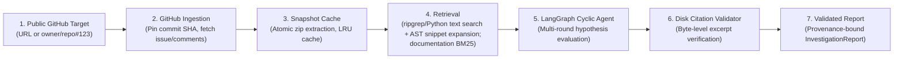

# IssueLens

[](https://www.python.org/downloads/)
[](https://fastapi.tiangolo.com/)
[](https://langchain-ai.github.io/langgraph/)
[](https://www.postgresql.org/)

**IssueLens** is an evidence-backed AI debugging assistant for public GitHub bug reports. It transforms public issue descriptions into structured bug investigations by combining deterministic lexical/AST code search, document retrieval, LangGraph cyclic reasoning, and byte-level citation validation against physical repository snapshots.

---

## Core Philosophy

- **Evidence-Backed**: Every code citation points to a repository-relative path, pinned commit SHA, and exact 1-indexed line range verified against physical snapshot bytes on disk. Fabricated citations are pruned; ungrounded hypotheses are demoted.
- **Investigation, Not Code Repair**: Provides developers with verified facts, ranked hypotheses, missing information, and reproducer test suggestions without generating untested code modifications or creating unprompted pull requests.
- **Strict Safety Boundaries**: Read-only repository inspection. Repository source code and untrusted issue text are quarantined in XML enclaves and **never executed**.

---

## Architecture & Pipeline at a Glance

IssueLens executes a deterministic, multi-stage investigation pipeline:



---

## Evaluation Benchmark

The IssueLens evaluation framework assesses investigation quality against historical GitHub bug reports under retrospective leak-prevention controls:
- **Pre-Fix Commit Pinning**: The repository snapshot provided to the investigation service is pinned to `target_commit_sha` (the pre-fix parent commit).
- **Double-Blind Scoring**: Ground-truth fix files and resolutions are stored exclusively in the evaluation dataset and are never exposed to the agent or injected into prompts.

The benchmark uses 20 real, closed bug reports from `BerriAI/litellm` generated via `scripts/build_eval_set.py`.

**Latest live run (metrics v2, 2026-11-26, `gpt-4o-mini`, clean tree at `fea2660`, [`evals/results.json`](evals/results.json)):** 20/20 cases produced a report. Root cause useful in **50%** (10 correct, 4 incorrect, 6 insufficient evidence; target 70%, not met). LLM citation validity 100% over 17 cases with citations and 0.35 unsupported claims per report (targets met). Search Recall@5 50.8% and Hit@5 60% (targets 80% / 90%, not met): retrieval is the main bottleneck. This is a 20-case, single-repository pilot; see [`evals/README.md`](evals/README.md) §7–8 for interpretation and limits.

A post-build audit (2026-11-25) found that the previously published figures ("100% citation validity", "0 unsupported claims", "70.6% correct root cause") could not have come out differently under the old metrics, and that issue comments leaked into the agent's context. The metrics and leak controls were rebuilt ([ADR-013](docs/decisions/ADR-013-evaluation-metric-redesign-and-leak-closure.md)); the old run is kept as [`evals/results.legacy-v1.json`](evals/results.legacy-v1.json) for reference only.

### Running the Benchmark

```bash
# Live benchmark (uses LLM + GitHub credentials from .env) -> evals/results.json
uv run python -m issuelens.evaluation.run_eval --live

# Offline harness check (no network). Echoes ground truth, so its scores are NOT a
# quality measurement -> evals/results.mock.json
uv run python -m issuelens.evaluation.run_eval
```

For full evaluation dataset details, live execution flags, and methodology, see [`evals/README.md`](evals/README.md).

---

## Quickstart

### Prerequisites

- Python 3.12+
- [`uv`](https://docs.astral.sh/uv/) (recommended) or standard `pip`

### 1. Installation

```bash
# Clone repository
git clone https://github.com/vishwaskotegar/Issuelens.git
cd Issuelens

# Create and activate virtual environment
uv venv --python 3.12
# On Windows (PowerShell):
.venv\Scripts\Activate.ps1
# On Linux/macOS:
source .venv/bin/activate

# Install dependencies in editable mode with development tools
uv pip install -e ".[dev]"

# Configure environment variables
cp .env.example .env
```

### 2. Start the Development Server

```bash
uv run uvicorn issuelens.main:app --reload --host 127.0.0.1 --port 8000
```

### 3. Run an Investigation via API

Investigate any public GitHub bug report by submitting an investigation request:

```bash
curl -X POST http://127.0.0.1:8000/v1/investigations \
  -H "Content-Type: application/json" \
  -d '{"issue_url": "https://github.com/pallets/flask/issues/4020", "execute": true}'
```

---

## Running with Docker Compose

To run the application and PostgreSQL database with Docker Compose:

```bash
# Build and run containers in background
docker compose up -d --build

# View container logs
docker compose logs -f app

# Run database migrations
docker compose exec app alembic upgrade head
```

---

## Security, Safety & Trust Boundaries

IssueLens enforces strict security controls at every layer:

| Domain | Control Policy | Implementation |
| :--- | :--- | :--- |
| **Code Execution** | **NEVER executed**. Untrusted repository code is inspected strictly via AST parsing and lexical text search. | Read-only Python AST parser & ripgrep |
| **Repository Mutation** | **NEVER modified**. IssueLens never creates git branches, commits, or pull requests. | Read-only snapshot extraction |
| **Prompt Injection** | Untrusted issue prose is quarantined in isolated XML enclaves; delimiter tags are escaped. | `sanitize_boundary_tags`, `prompts.py` |
| **SSRF Defenses** | Issue URLs are parsed, never fetched: only `github.com` / `www.github.com` hosts are accepted and all API calls go to `api.github.com`. | `url_parser.py` host allowlist |
| **Client IP Spoofing** | `X-Forwarded-For` is only read from `TRUSTED_PROXIES` peers, and the right-most untrusted hop is used as the client. | `security.py` (`get_client_identifier`) |
| **HTTP Hardening** | Security headers (`X-Content-Type-Options: nosniff`, `X-Frame-Options: DENY`, `Referrer-Policy`, HSTS in production/HTTPS; no CSP) and constant-time API key verification. Also applied to unhandled-exception 500 responses. | `secrets.compare_digest`, `apply_security_headers` in `main.py` |
| **Citation Integrity** | 100% of code excerpts verified against snapshot bytes; ungrounded citations pruned. | `validate_investigation_report()`, `validator.py` |

---

## Phased Engineering Milestones

IssueLens was built through disciplined, test-driven phases conforming to [`docs/BUILD_SPECIFICATION.md`](docs/BUILD_SPECIFICATION.md):

| Phase | Milestone | Key Deliverables | ADR |
| :--- | :--- | :--- | :--- |
| **Phase 0** | Repository Bootstrap | Strict typing (`mypy`), linting (`ruff`), Pydantic Settings, `/healthz`, secret redaction. | — |
| **Phase 1** | GitHub Issue Ingestion | Async REST client, URL/SSRF parser, coordinate resolution, pinned commit SHA discovery. | [ADR-001](docs/decisions/ADR-001-github-api-client.md) |
| **Phase 2** | Code Search Baseline | Ripgrep integration, AST symbol extraction, line-numbered snippet reader, LRU snapshot cache. | [ADR-004](docs/decisions/ADR-004-commit-pinned-snapshot-cache-and-disk-bounds.md) |
| **Phase 3** | First End-to-End Report | Structured LLM adapter with LangChain, XML prompt injection enclaves, orchestrator service. | [ADR-002](docs/decisions/ADR-002-llm-provider-adapter-and-report-generation.md) |
| **Phase 4** | Evidence Validation | Deterministic citation validation, excerpt byte matching, insufficient-evidence fallbacks. | [ADR-003](docs/decisions/ADR-003-deterministic-citation-validation-and-insufficient-evidence.md) |
| **Phase 5** | LangGraph State Machine | Multi-round cyclic agent graph, conditional routing, tool traces, relevance ranking. | [ADR-005](docs/decisions/ADR-005-langgraph-agent-workflow-and-state-machine.md), [ADR-006](docs/decisions/ADR-006-deterministic-evidence-ranking.md) |
| **Phase 6** | Persistence & History | PostgreSQL with async SQLAlchemy 2.0, Alembic migrations, restart survivability. | [ADR-007](docs/decisions/ADR-007-postgresql-persistence-and-alembic-migrations.md) |
| **Phase 7** | Evaluation Benchmark | 20-case retrospective benchmark, leak-prevention harness, deterministic evaluation metrics. | [ADR-008](docs/decisions/ADR-008-evaluation-harness-and-retrospective-benchmark.md) |
| **Phase 8** | Document RAG | Heading-preserving markdown chunker, pure-Python Okapi BM25, hybrid Reciprocal Rank Fusion. | [ADR-009](docs/decisions/ADR-009-document-rag-and-hybrid-retrieval.md) |
| **Phase 9** | Deployment Hardening | Multi-stage unprivileged Docker container, compose orchestration, constant-time token auth, rate limiting. | [ADR-010](docs/decisions/ADR-010-production-deployment-and-api-hardening.md) |
| **Phase 10**| Security Hardening | Anti-spoofing trusted proxy validation, HTTP security headers, prompt-injection tag escaping. | [ADR-011](docs/decisions/ADR-011-security-hardening-and-trusted-proxy-defense.md) |

---

## Running Quality Checks

Execute all verification checks locally:

```bash
# Run unit and integration tests
uv run pytest

# Run linter
uv run ruff check .

# Run static type checker
uv run mypy src tests
```

---

## API Endpoints

- **Liveness Probe**: `GET /healthz`
- **Readiness Probe (DB connectivity)**: `GET /readyz`
- **Interactive Swagger Documentation**: `GET /docs`
- **Ingest Public Issue**: `POST /v1/issues/ingest`
- **Create Investigation Run**: `POST /v1/investigations`
- **Execute Existing Investigation**: `POST /v1/investigations/{run_id}/execute`
- **Retrieve Investigation Run & Status**: `GET /v1/investigations/{run_id}`

---

## Codebase Architecture & Directory Map

```text
issuelens/
  ├── pyproject.toml              # Build & dependency metadata
  ├── README.md                   # Project overview, benchmark, and instructions
  ├── AGENTS.md                   # AI coding assistant guidelines & safety boundaries
  ├── docker-compose.yml          # Production multi-service orchestration
  ├── Dockerfile                  # Multi-stage hardened unprivileged container
  ├── evals/
  │   ├── README.md               # Benchmark methodology, targets, and baseline results
  │   ├── cases.jsonl             # 20 curated public Python bug cases
  │   └── results.legacy-v1.json  # Superseded pre-audit run (metrics v1; reference only)
  ├── docs/
  │   ├── BUILD_SPECIFICATION.md  # Master product & engineering build specification
  │   ├── BUILD_LOG.md            # Engineering journal & verified debugging lessons
  │   ├── LEARNING_GUIDE.md       # Step-by-step mentor guide covering every subsystem
  │   ├── architecture/           # Blueprints, sequence flows, state machine & boundaries
  │   │   ├── README.md           # Architecture index & reading order
  │   │   ├── system-overview.md  # Component architecture & integrations
  │   │   ├── request-lifecycle.md# End-to-end tracing and error flows
  │   │   ├── agent-workflow.md   # LangGraph cyclic state machine
  │   │   ├── codebase-map.md     # Symbol directory & change navigation
  │   │   ├── data-flow-and-trust-boundaries.md # Threat model & security controls
  │   │   └── testing-and-evaluation.md         # Test pyramid & evaluation metrics
  │   └── decisions/              # Architecture Decision Records (ADR-001 to ADR-011)
  └── src/issuelens/
      ├── main.py                 # FastAPI application factory & security middleware
      ├── config.py               # Pydantic Settings & environment validation
      ├── agent/                  # LangGraph state machine, nodes, prompts, validator
      ├── api/                    # REST routes, schemas, and security authentication
      ├── core/                   # Domain exceptions, structured logging & secret redaction
      ├── evaluation/             # Benchmark dataset loader, metrics, and CLI runner
      ├── github/                 # GitHub REST client, URL/SSRF parser, commit resolver
      ├── persistence/            # SQLAlchemy 2.0 ORM, migrations, and repository pattern
      ├── repository/             # Ripgrep code search, AST symbols, snapshot cache
      └── retrieval/              # Heading-preserving chunker, BM25 index (RRF code present but inactive: no embedder)
```

---

## Documentation Ecosystem

- **[`docs/BUILD_SPECIFICATION.md`](docs/BUILD_SPECIFICATION.md)**: Product source of truth, architecture overview, security boundaries, and phased build plan.
- **[`docs/architecture/`](docs/architecture/)**: Architecture blueprints, sequence flows, state machine designs, and trust boundary diagrams.
- **[`docs/LEARNING_GUIDE.md`](docs/LEARNING_GUIDE.md)**: Senior-to-junior engineering walkthrough detailing how every feature works step-by-step with real code references and trade-offs.
- **[`docs/BUILD_LOG.md`](docs/BUILD_LOG.md)**: Engineering journal documenting verified root causes, code fixes, regression tests, and lessons learned from real implementation bugs.
- **[`docs/decisions/`](docs/decisions/)**: Architecture Decision Records (ADRs) tracking significant architectural choices, alternatives considered, and conditions for reconsideration.
- **[`evals/README.md`](evals/README.md)**: Evaluation benchmark dataset documentation, metric definitions, and baseline analysis.
- **[`AGENTS.md`](AGENTS.md)**: AI agent rules and safety boundaries maintained at the repository root.
