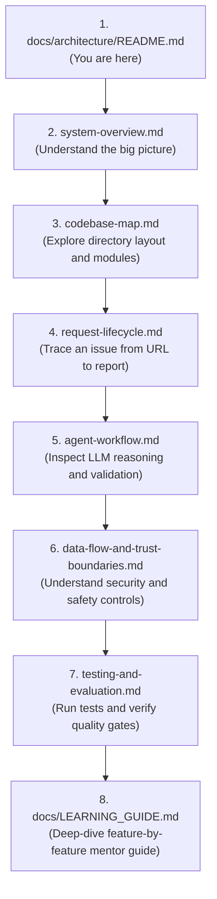

# IssueLens Architecture Documentation

Welcome to the **IssueLens Architecture Documentation**. This directory contains the architectural blueprints, sequence flows, state machine specifications, codebase maps, data flow boundaries, and testing/evaluation strategies for IssueLens.

---

## 1. Purpose of This Documentation

IssueLens is an **evidence-backed AI debugging assistant for public GitHub bug reports**. Its architectural mission is to transform untrusted public issue descriptions into rigorously verified, reproducible bug investigation reports. 

Unlike conversational coding assistants that guess causes or hallucinate code paths, IssueLens enforces a **deterministic evidence pipeline**:
- Every code citation is pinned to an immutable git commit SHA.
- Every citation is physically verified against actual repository files on disk.
- Unverified citations are pruned, and ungrounded hypotheses are demoted.
- Untrusted repository code is inspected in read-only mode and is **never executed**.

This documentation explains both **what the system does** and **how its implementation works**, establishing clear boundaries between implemented components and planned future capabilities.

---

## 2. Architecture Document Index

The architecture is documented across six core blueprints:

| Document | Title | Purpose & Scope |
| :--- | :--- | :--- |
| [**`system-overview.md`**](file:///c:/Projects/Issuelens/docs/architecture/system-overview.md) | System Overview | High-level component architecture, responsibilities, inputs/outputs, and integration contracts. |
| [**`request-lifecycle.md`**](file:///c:/Projects/Issuelens/docs/architecture/request-lifecycle.md) | Request Lifecycle & Execution Paths | End-to-end request tracing from HTTP submission to verified report, including all failure paths. |
| [**`agent-workflow.md`**](file:///c:/Projects/Issuelens/docs/architecture/agent-workflow.md) | Agent Workflow & State Machine | Current synchronous orchestrator and planned LangGraph multi-round cyclic state machine. |
| [**`codebase-map.md`**](file:///c:/Projects/Issuelens/docs/architecture/codebase-map.md) | Codebase Map & Package Boundaries | Module dependencies, structural layering, symbol directory, and developer change navigation. |
| [**`data-flow-and-trust-boundaries.md`**](file:///c:/Projects/Issuelens/docs/architecture/data-flow-and-trust-boundaries.md) | Data Flow & Trust Boundaries | Threat modeling, untrusted data enclaves, prompt injection defenses, and security limits. |
| [**`testing-and-evaluation.md`**](file:///c:/Projects/Issuelens/docs/architecture/testing-and-evaluation.md) | Testing & Evaluation Architecture | Hermetic test suites, test doubles, leak-proof retrospective benchmarks, and evaluation metrics. |

---

## 3. Recommended Reading Order for Newcomers

If you are joining the IssueLens project or learning its design, follow this reading path:

---

## 4. Diagram Conventions & Visual Legend

All diagrams are rendered using standard GitHub-compatible Mermaid Markdown syntax.

### Standard Mermaid Theme Policy
- **Standard/Default Theme**: Diagrams use Mermaid's standard theme without custom global themes (`%%{init: ...}%%`) or hardcoded color overrides. This ensures optimal rendering and readability across both light and dark display modes in GitHub and documentation viewers.
- **No Decorative Styling**: Node backgrounds, text colors, and edge colors are not hardcoded solely for aesthetic appearance.
- **Semantic Styling Only**: Styling directives are permitted only when communicating essential semantics—specifically, `stroke-dasharray: 5 5` to represent **planned, unimplemented components**—and must never force hardcoded background fills.
- **Ongoing Review**: Existing diagrams must be checked for theme consistency whenever modified, and syntax must be validated during phase verification.

### Visual Notations

| Visual Style | Meaning | Example |
| :--- | :--- | :--- |
| **Solid Outline (`box`)** | **Implemented Component**: Fully built, tested, and active in the codebase (Phases 0–4). | `[FastAPI API Router]` |
| **Dashed Outline (`box` with `stroke-dasharray`)** | **Planned Component**: Formally specified in `BUILD_SPECIFICATION.md` but not yet implemented (Phases 5–9). | `[LangGraph State Machine]` |
| **Solid Arrow (`-->`)** | **Synchronous Control Flow** or Direct Method Invocation. | `Client --> Service` |
| **Dotted Arrow (`-.->`)** | **Data Dependency**, Injected Protocol, or Cache Query. | `Service -.-> SnapshotCache` |
| **Thick Double Border** | **Security / Trust Boundary**: Delineates untrusted external input from validated internal state. | `{{Trust Boundary}}` |

---

## 5. Current Implementation State vs. Planned Roadmap

IssueLens follows a disciplined, phase-gated engineering methodology:

```mermaid
flowchart LR
    subgraph Implemented["Implemented Baseline (Phases 0 - 4)"]
        direction TB
        P0["Phase 0: Bootstrap & Health"]
        P1["Phase 1: GitHub Target Ingestion"]
        P2["Phase 2: Code Search & Snapshot Cache"]
        P3["Phase 3: LLM Report Generation"]
        P4["Phase 4: Evidence Validation Guardrails"]
        P0 --> P1 --> P2 --> P3 --> P4
    end

    subgraph Planned["Planned Roadmap (Phases 5 - 9)"]
        direction TB
        P5["Phase 5: LangGraph Multi-Round Workflow"]
        P6["Phase 6: PostgreSQL Run Persistence"]
        P7["Phase 7: Retrospective Evaluation Benchmark"]
        P8["Phase 8: Document RAG & Hybrid Retrieval"]
        P9["Phase 9: Production Container & Workers"]
        P5 --> P6 --> P7 --> P8 --> P9
    end

    P4 -.-> P5

    style Planned stroke-dasharray: 5 5
```

- **Implemented (Phases 0–4)**: Complete vertical slice accepting public GitHub URLs, fetching issue metadata, extracting commit-pinned snapshot archives, executing ripgrep/Python code search, extracting AST symbols, generating structured LLM reports with prompt injection defense, validating citations against physical disk files, demoting ungrounded hypotheses, and caching snapshots with bounded LRU eviction.
- **Planned (Phases 5–9)**: LangGraph multi-turn reflection loop, PostgreSQL run/report persistence, automated retrospective evaluation harness with pre-fix leak prevention, document chunking/BM25/vector retrieval, and asynchronous background worker queues.

---

## 6. Architecture Maintenance Protocol

Architecture diagrams and specifications are living assets synchronized with the code:
1. **Synchronous Updates**: Whenever an implementation change alters component boundaries, data models, or control flows, the corresponding diagrams in this directory must be updated in the **exact same phase**.
2. **Accurate Labeling**: Never depict planned functionality as implemented. Use dashed boxes and explicit `[PLANNED]` tags for forward-looking designs.
3. **Link to Code**: Diagram explanations must link to real repository files, protocols, and symbols.
