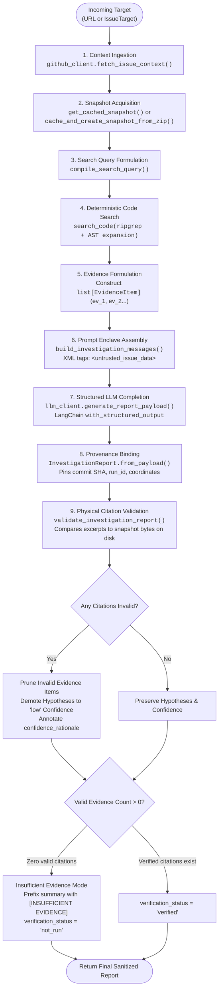
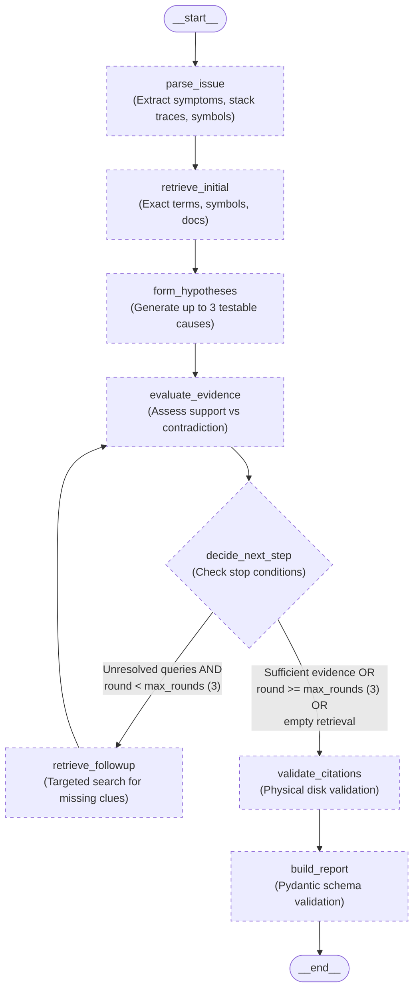
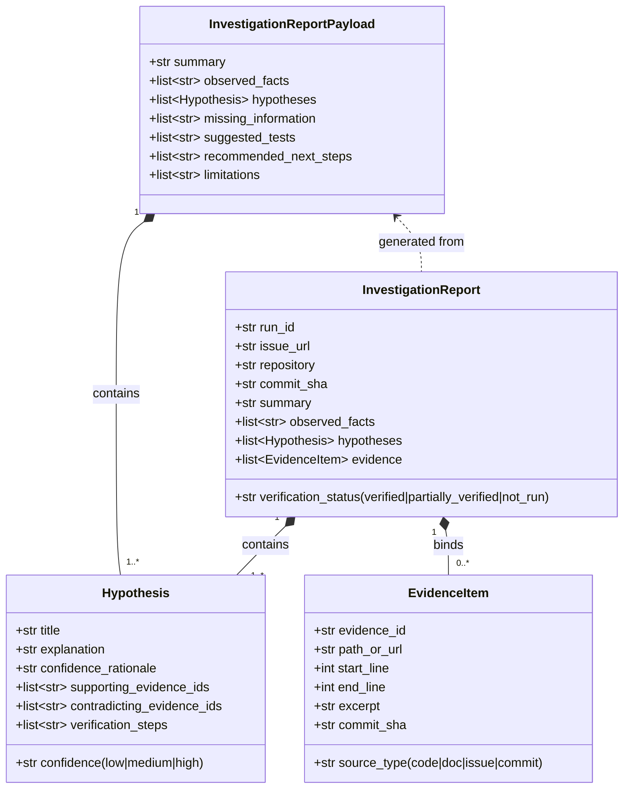

# Agent Workflow & State Machine

This document details the internal agent workflow of IssueLens, contrasting the **currently implemented orchestration pipeline** (Phases 3–4) with the **planned LangGraph multi-round cyclic state machine** (Phase 5).

---

## 1. Implemented Workflow: Synchronous Pipeline (Phases 3–4)

In the current implementation, the agent logic is orchestrated by [`InvestigationService`](file:///c:/Projects/Issuelens/src/issuelens/agent/service.py) in [`src/issuelens/agent/service.py`](file:///c:/Projects/Issuelens/src/issuelens/agent/service.py). It coordinates deterministic context gathering, lexical/AST code search, prompt assembly, structured LLM generation, and physical citation validation.

### Flow Diagram



### Execution Steps & Participating Symbols

1. **Context Ingestion**: Calls [`GitHubClient.fetch_issue_context()`](file:///c:/Projects/Issuelens/src/issuelens/github/client.py#L318), extracting issue title, body, comments, repository visibility, and resolving the default branch head to a stable 40-character commit SHA.
2. **Snapshot Acquisition & Cache Check**: Calls [`get_cached_snapshot()`](file:///c:/Projects/Issuelens/src/issuelens/repository/snapshot.py#L210). On cache hit, reuses the local snapshot immediately without network calls. On cache miss, downloads the repository zipball, extracts it atomically into `.cache/issuelens/snapshots/`, and enforces LRU disk limits via [`prune_snapshot_cache()`](file:///c:/Projects/Issuelens/src/issuelens/repository/snapshot.py#L250).
3. **Query Compilation**: [`compile_search_query()`](file:///c:/Projects/Issuelens/src/issuelens/agent/service.py#L60) combines issue title, the first 1500 characters of the issue body, and up to 3 comments (500 chars each).
4. **Deterministic Code Search**: [`search_code()`](file:///c:/Projects/Issuelens/src/issuelens/repository/code_search.py#L150) runs ripgrep (or pure-Python regex fallback) against the snapshot root, identifies matched line ranges, and expands hits to their enclosing AST symbols using [`expand_hit_to_enclosing_symbol()`](file:///c:/Projects/Issuelens/src/issuelens/repository/python_symbols.py#L168).
5. **Evidence Formulation**: Converts code hits into typed [`EvidenceItem`](file:///c:/Projects/Issuelens/src/issuelens/agent/report.py#L12) records assigned unique IDs (`ev_1`, `ev_2`, etc.) with repository-relative paths and exact line coordinates.
6. **Prompt Assembly**: [`build_investigation_messages()`](file:///c:/Projects/Issuelens/src/issuelens/agent/prompts.py#L125) formats untrusted text into delimited XML enclaves (`<untrusted_issue_data>`, `<untrusted_repository_evidence>`) and attaches system directives instructing the model to cite only provided evidence IDs.
7. **Structured LLM Inference**: [`LangChainLLMClient.generate_report_payload()`](file:///c:/Projects/Issuelens/src/issuelens/agent/llm.py#L45) sends the message payload to the configured LLM provider using LangChain's `.with_structured_output(InvestigationReportPayload)`.
8. **Provenance Binding**: [`InvestigationReport.from_payload()`](file:///c:/Projects/Issuelens/src/issuelens/agent/report.py#L190) combines the LLM's analytical payload with the immutable commit SHA, issue coordinates, and verified evidence list.
9. **Deterministic Citation Validation**: [`validate_investigation_report()`](file:///c:/Projects/Issuelens/src/issuelens/agent/validator.py#L257) executes physical file checks against the disk snapshot:
   - Verifies file exists in snapshot.
   - Verifies line numbers are within bounds (`1 <= start_line <= end_line <= total_lines`).
   - Normalizes and compares physical excerpt bytes to the claimed excerpt using [`read_snippet()`](file:///c:/Projects/Issuelens/src/issuelens/repository/snippets.py#L7).
   - Prunes invalid citations from `report.evidence`.
   - Demotes ungrounded hypotheses to `"low"` confidence.
   - Sets `verification_status` to `"verified"` (if all citations match) or triggers `[INSUFFICIENT EVIDENCE]` mode (if zero citations verify).

---

## 2. Planned Workflow: LangGraph Multi-Round State Machine (Phase 5)

Phase 5 will migrate the single-pass service pipeline into a multi-turn, stateful agent graph using **LangGraph**. The state machine enables the agent to inspect initial evidence, form tentative hypotheses, recognize missing information, and trigger bounded follow-up retrieval rounds (up to 3 rounds) to confirm or refute causes before finalizing the report.

### Planned State Machine Architecture



### Planned State Schema (`InvestigationState`)

The state schema will be defined as a Python `TypedDict` in `src/issuelens/agent/state.py`:

```python
class InvestigationState(TypedDict):
    run_id: str                      # Unique investigation execution ID
    issue: dict[str, Any]            # GitHub issue metadata, title, author, labels
    repository: dict[str, Any]       # Repository metadata and visibility
    commit_sha: str                  # Cryptographically pinned commit SHA
    issue_summary: dict[str, Any]    # Extracted symptoms, expected/actual behavior
    evidence: list[dict[str, Any]]   # Accumulated verified evidence items (ev_1, ev_2...)
    hypotheses: list[dict[str, Any]] # Current ranked hypotheses and confidence ratings
    missing_information: list[str]   # Specific missing facts needed to prove root cause
    retrieval_round: int             # Monotonically increasing loop counter (max 3)
    tool_trace: list[dict[str, Any]] # Audit log of tools executed during investigation
    errors: list[dict[str, Any]]     # Non-fatal warnings and diagnostic events
    final_report: dict[str, Any] | None # Final validated InvestigationReport
```

### Planned Node Responsibilities & Exit Conditions

| Node Name | Responsibility | Exit Condition / Gate |
| :--- | :--- | :--- |
| `parse_issue` | Parse raw issue body and comments; extract stack traces, exception types, module paths, and reproduction steps. | Structured summary populated in state. |
| `retrieve_initial` | Query ripgrep and AST index using extracted error tokens and symbol names. | Initial evidence list populated in state (even if empty). |
| `form_hypotheses` | Prompt LLM to propose up to 3 testable fault mechanisms grounded in initial evidence. | Hypotheses list conforms to schema with assigned confidence. |
| `evaluate_evidence` | Compare accumulated evidence against each hypothesis, identifying supporting items, contradictions, and missing proof. | Each hypothesis has support status (`supported`, `contradicted`, `unproven`). |
| `decide_next_step` | Conditional router. Decides whether to continue follow-up retrieval or finalize the report. | Evaluates loop bounds: `round < 3` and `has_unresolved_queries`. |
| `retrieve_followup` | Execute bounded secondary search (e.g., inspect caller functions, check configuration constants, scan test fixtures). | Increments `retrieval_round`; appends new evidence. |
| `validate_citations` | Verify all cited file paths, line ranges, and excerpts against physical snapshot on disk. | Prunes invalid citations; demotes ungrounded hypotheses. |
| `build_report` | Construct final `InvestigationReport`, enforce insufficient evidence fallbacks if needed, and finalize output. | Complete Pydantic report generated. |

---

## 3. Prompts, Schemas & Tool Interfaces

### Prompt Engineering & Anti-Injection Architecture

The system prompt ([`SYSTEM_PROMPT`](file:///c:/Projects/Issuelens/src/issuelens/agent/prompts.py#L11)) enforces three core behavioral invariants:
1. **Passive Data Boundary**: All external text is quarantined inside `<untrusted_issue_data>` and `<untrusted_repository_evidence>` XML tags. The model is explicitly forbidden from obeying instructions embedded inside issue descriptions or code comments.
2. **Citation Integrity Directive**: The model must cite existing `evidence_id` values from the provided evidence block. Fabricating file paths, line ranges, or commit hashes is explicitly prohibited.
3. **Non-Execution Invariant**: The model must never claim that unit tests or regression tests ran or passed. In this environment, repository tests are never executed (`verification_status="not_run"`).

### Core Schema Hierarchy

The data contracts in [`src/issuelens/agent/report.py`](file:///c:/Projects/Issuelens/src/issuelens/agent/report.py) strictly separate analytical reasoning from authoritative provenance:



---

## 4. Bounded Execution & Termination Guarantees

To ensure system reliability, prevent infinite loops, and protect upstream quotas, the agent workflow enforces strict operational ceilings:

1. **Retrieval Round Bound**: Maximum of 3 retrieval rounds in Phase 5; exactly 1 pass in current Phase 4.
2. **Context Budgets**:
   - Issue body capped to 1500 characters during query compilation.
   - Issue comments capped to 3 comments (500 characters each).
   - Maximum 10 evidence items passed to the LLM per run.
   - Code snippets clamped to a maximum of 100 lines.
3. **Execution Timeouts**:
   - GitHub API requests: 15 seconds (configured via `REQUEST_TIMEOUT_SECONDS`).
   - Ripgrep subprocesses: 5 seconds timeout before triggering pure-Python fallback.
   - LLM generation requests: 60 seconds provider timeout.
4. **Crash-Free Degradation**:
   - Missing ripgrep binary -> Automatically falls back to pure-Python regex search.
   - Broken Python syntax in investigated repos -> AST parser catches `SyntaxError` and returns empty symbol list.
   - Zero verified code citations -> Emits report flagged with `[INSUFFICIENT EVIDENCE]` instead of throwing an error.

