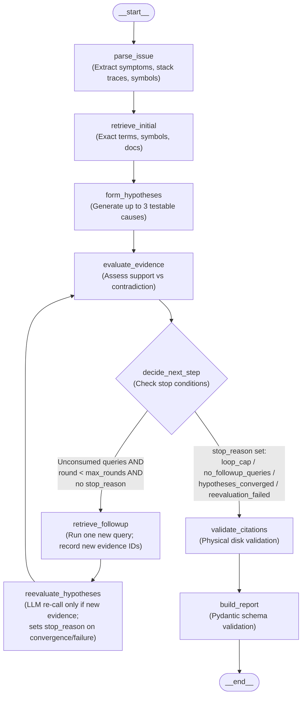
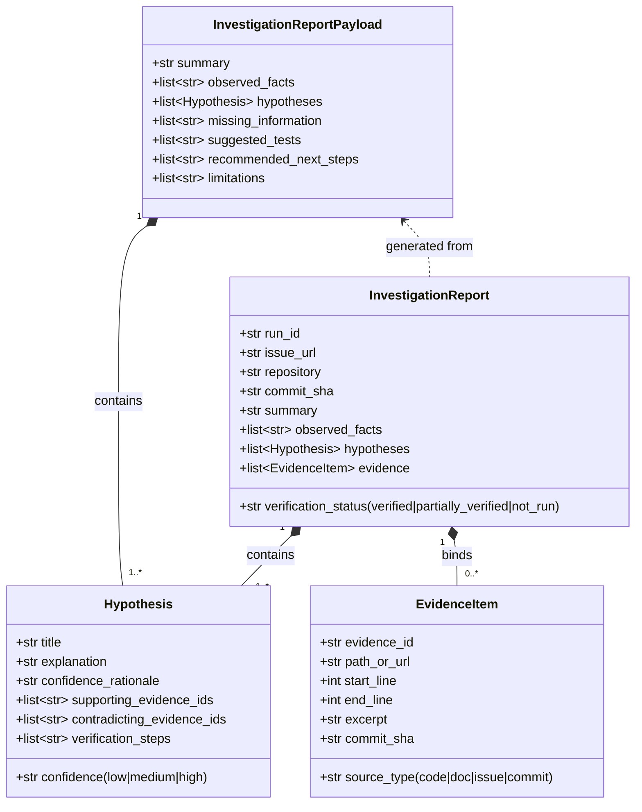

# Agent Workflow & State Machine

This document details the internal agent workflow of IssueLens, documenting both the foundational single-pass pipeline (Phases 3–4) and the active **LangGraph multi-round cyclic state machine** (Phase 5).

---

## 1. Historical Workflow: Synchronous Pipeline (Phases 3–4, superseded)

> **Superseded by Section 2.** `InvestigationService.investigate()` now runs the LangGraph state machine. Helpers referenced below (`compile_search_query`, `extract_json_payload`, `InvestigationReport.from_payload`) were removed in the 2026-11-27 audit cleanup; the section is kept as a record of the Phase 3–4 design.

In the current implementation, the agent logic is orchestrated by [`InvestigationService`](../../src/issuelens/agent/service.py) in [`src/issuelens/agent/service.py`](../../src/issuelens/agent/service.py). It coordinates deterministic context gathering, lexical/AST code search, prompt assembly, structured LLM generation, and physical citation validation.

### Flow Diagram

```mermaid
flowchart TD
    Start(["Incoming Target<br/>(URL or IssueTarget)"]) --> Step1["1. Context Ingestion<br/><code>github_client.fetch_issue_context()</code>"]
    
    Step1 --> Step2["2. Snapshot Acquisition<br/><code>get_cached_snapshot()</code> or<br/><code>cache_and_create_snapshot_from_zip()</code>"]
    
    Step2 --> Step3["3. Search Query Formulation<br/><code>compile_search_query()</code>"]
    
    Step3 --> Step4["4. Deterministic Code Search<br/><code>search_code(ripgrep + AST expansion)</code>"]
    
    Step4 --> Step5["5. Evidence Formulation<br/>Construct <code>list&#91;EvidenceItem&#93;</code> (ev_1, ev_2...)"]
    
    Step5 --> Step6["6. Prompt Enclave Assembly<br/><code>build_investigation_messages()</code><br/>XML tags: &lt;untrusted_issue_data&gt;"]
    
    Step6 --> Step7["7. Structured LLM Completion<br/><code>llm_client.generate_report_payload()</code><br/>LangChain <code>with_structured_output</code>"]
    
    Step7 --> Step8["8. Provenance Binding<br/><code>InvestigationReport.from_payload()</code><br/>Pins commit SHA, run_id, coordinates"]
    
    Step8 --> Step9["9. Physical Citation Validation<br/><code>validate_investigation_report()</code><br/>Compares excerpts to snapshot bytes on disk"]
    
    Step9 --> Gate1{"Any Citations Invalid?"}
    Gate1 -- Yes --> Action1["Prune Invalid Evidence Items<br/>Demote Hypotheses to 'low' Confidence<br/>Annotate confidence_rationale"]
    Gate1 -- No --> Action2["Preserve Hypotheses & Confidence"]
    
    Action1 --> Gate2{"Valid Evidence Count > 0?"}
    Action2 --> Gate2
    
    Gate2 -- Zero valid citations --> Action3["Insufficient Evidence Mode<br/>Prefix summary with &#91;INSUFFICIENT EVIDENCE&#93;<br/>verification_status = 'not_run'"]
    Gate2 -- Verified citations exist --> Action4["verification_status = 'verified'"]
    
    Action3 --> End(["Return Final Sanitized Report"])
    Action4 --> End
```



### Execution Steps & Participating Symbols

1. **Context Ingestion**: Calls [`GitHubClient.fetch_issue_context()`](../../src/issuelens/github/client.py), extracting issue title, body, comments, repository visibility, and resolving candidate release tags (`v{version}`, `{version}`) before falling back to default branch head to pin a stable 40-character commit SHA.
2. **Snapshot Acquisition & Cache Check**: Calls [`get_cached_snapshot()`](../../src/issuelens/repository/snapshot.py). On cache hit, reuses the local snapshot immediately without network calls. On cache miss, downloads the repository zipball, extracts it atomically into `.cache/issuelens/snapshots/`, and enforces LRU disk limits via [`prune_snapshot_cache()`](../../src/issuelens/repository/snapshot.py).
3. **Query Compilation**: [`compile_search_query()`](../../src/issuelens/agent/service.py) combines issue title, the first 1500 characters of the issue body, and up to 3 comments (500 chars each).
4. **Dual-Engine Code and Document Search**:
   - [`search_code()`](../../src/issuelens/repository/code_search.py) runs ripgrep (or pure-Python regex fallback) against the snapshot root, identifies matched line ranges, expands hits to their enclosing AST symbols via [`find_enclosing_symbol()`](../../src/issuelens/repository/python_symbols.py), filters comment-only excerpts via `has_code_substance()`, and ranks results deterministically.
   - [`DocumentRetriever`](../../src/issuelens/retrieval/documents.py) (Phase 8) scans `README.md`, `docs/`, and issue context, chunks text along headings and paragraph boundaries with 1-indexed line spans, and retrieves passages using Okapi BM25 and hybrid Reciprocal Rank Fusion (RRF), providing complementary coverage for configuration, architectural, and policy documentation that raw code search lacks.
5. **Evidence Formulation**: Converts code hits into typed [`EvidenceItem`](../../src/issuelens/agent/report.py) records assigned unique IDs (`ev_1`, `ev_2`, etc.) with repository-relative paths and exact line coordinates.
6. **Prompt Assembly**: [`build_investigation_messages()`](../../src/issuelens/agent/prompts.py) formats untrusted text into delimited XML enclaves (`<untrusted_issue_data>`, `<untrusted_repository_evidence>`) and attaches system directives instructing the model to cite only directly demonstrated defect mechanisms and avoid blaming external plugins for regressions.
7. **Structured LLM Inference**: [`LangChainLLMClient.generate_report_payload()`](../../src/issuelens/agent/llm.py) sends the message payload to the configured LLM provider using LangChain's `.with_structured_output(InvestigationReportPayload)`.
8. **Provenance Binding**: [`InvestigationReport.from_payload()`](../../src/issuelens/agent/report.py) combines the LLM's analytical payload with the immutable commit SHA, issue coordinates, and verified evidence list.
9. **Deterministic Citation Validation**: [`validate_investigation_report()`](../../src/issuelens/agent/validator.py) executes physical file checks against the disk snapshot:
   - Verifies file exists in snapshot.
   - Verifies line numbers are within bounds (`1 <= start_line <= end_line <= total_lines`).
   - Normalizes and compares physical excerpt bytes to the claimed excerpt using [`read_snippet()`](../../src/issuelens/repository/snippets.py).
   - Enforces code substance guardrail (`has_code_substance`), rejecting comment-only code snippets.
   - Prunes invalid citations from `report.evidence`.
   - Demotes ungrounded hypotheses to `"low"` confidence.
   - Sets `verification_status` to `"verified"` (if all citations match) or triggers `[INSUFFICIENT EVIDENCE]` mode (if zero citations verify).

---

## 2. Implemented Workflow: LangGraph Multi-Round State Machine (Phase 5)

In Phase 5, the agent workflow is orchestrated via a multi-turn, stateful agent graph using **LangGraph** (`src/issuelens/agent/graph.py`). The state machine inspects initial evidence, forms tentative hypotheses, identifies missing information, and triggers bounded follow-up retrieval rounds (`MAX_RETRIEVAL_ROUNDS`, default 3). After each follow-up round that adds evidence, `reevaluate_hypotheses` re-calls the LLM with its prior hypotheses and the new evidence so it can keep, revise, or drop them ([ADR-012](../decisions/ADR-012-llm-hypothesis-reevaluation-loop.md)). Before the 2026-11-25 audit the LLM was called only once and follow-up rounds repeated the same query.

### State Machine Architecture



### Implemented State Schema (`InvestigationState`)

The state schema is defined as a typed Python `TypedDict` in [`src/issuelens/agent/state.py`](../../src/issuelens/agent/state.py):

```python
class InvestigationState(TypedDict, total=False):
    run_id: str                      # Unique investigation execution ID
    issue: dict[str, Any]            # GitHub issue metadata, title, author, labels
    repository: dict[str, Any]       # Repository metadata and visibility
    commit_sha: str                  # Cryptographically pinned commit SHA
    issue_summary: dict[str, Any]    # Extracted symptoms, expected/actual behavior
    evidence: list[dict[str, Any]]   # Accumulated verified evidence items (ev_1, ev_2...)
    hypotheses: list[dict[str, Any]] # Current ranked hypotheses and confidence ratings
    missing_information: list[str]   # Specific missing facts needed to prove root cause
    retrieval_round: int             # Monotonically increasing loop counter (max 3)
    tool_trace: list[ToolTraceItem]  # Audit log of tools executed during investigation
    errors: list[dict[str, Any]]     # Non-fatal warnings and diagnostic events
    final_report: dict[str, Any] | None # Final validated InvestigationReport
    max_retrieval_rounds: int        # Loop cap (MAX_RETRIEVAL_ROUNDS, default 3)
    followup_queries: list[str]      # Queued search queries for secondary retrieval
    consumed_queries: list[str]      # Queries already executed; never re-queued
    new_evidence_ids: list[str]      # Evidence added by the latest follow-up round
    llm_calls: int                   # Initial formation + re-evaluation calls
    stop_reason: str | None          # loop_cap | no_followup_queries |
                                     # hypotheses_converged | reevaluation_failed
```

### Implemented Node Responsibilities & Exit Conditions

| Node Name | Responsibility | Exit Condition / Gate |
| :--- | :--- | :--- |
| `parse_issue` | Parse raw issue body and comments; extract stack traces, exception types, module paths, and reproduction steps. | Structured summary populated in state. |
| `retrieve_initial` | Query ripgrep and AST index using extracted error tokens and symbol names. | Initial evidence list populated in state (even if empty). |
| `form_hypotheses` | Prompt LLM to propose up to 3 testable fault mechanisms grounded in initial evidence. | Hypotheses list conforms to schema with assigned confidence. |
| `evaluate_evidence` | Mark each hypothesis `supported`/`unsupported` (cited IDs exist) and build follow-up queries from identifier-like terms in `missing_information` and unsupported hypotheses, excluding `consumed_queries`. | Sets `stop_reason` to `loop_cap` or `no_followup_queries` when applicable (never overwrites an existing reason). |
| `decide_next_step` | Conditional router. | Routes to validation if `stop_reason` is set, `retrieval_round >= max_retrieval_rounds`, or no queries remain. |
| `retrieve_followup` | Run the next unconsumed query (code + documentation search). | Increments `retrieval_round`; appends evidence; records `consumed_queries` and `new_evidence_ids`. |
| `reevaluate_hypotheses` | If the round added evidence, re-call the LLM with prior hypotheses and the full evidence list (new items marked). | Replaces hypotheses/missing info; sets `hypotheses_converged` if unchanged, `reevaluation_failed` (keeping prior hypotheses) on error; `skipped` without new evidence. |
| `validate_citations` | Verify all cited file paths, line ranges, and excerpts against physical snapshot on disk. | Prunes invalid citations; demotes ungrounded hypotheses; sets final `support_status`. |
| `build_report` | Construct final `InvestigationReport`, enforce insufficient evidence fallbacks if needed, and finalize output. | Complete Pydantic report generated. |

---

## 3. Prompts, Schemas & Tool Interfaces

### Prompt Engineering & Anti-Injection Architecture

The system prompt ([`SYSTEM_PROMPT`](../../src/issuelens/agent/prompts.py)) enforces three core behavioral invariants:
1. **Passive Data Boundary**: All external text is quarantined inside `<untrusted_issue_data>` and `<untrusted_repository_evidence>` XML tags. The model is explicitly forbidden from obeying instructions embedded inside issue descriptions or code comments.
2. **Citation Integrity Directive**: The model must cite existing `evidence_id` values from the provided evidence block. Fabricating file paths, line ranges, or commit hashes is explicitly prohibited.
3. **Non-Execution Invariant**: The model must never claim that unit tests or regression tests ran or passed. In this environment, repository tests are never executed (`verification_status="not_run"`).

### Core Schema Hierarchy

The data contracts in [`src/issuelens/agent/report.py`](../../src/issuelens/agent/report.py) strictly separate analytical reasoning from authoritative provenance:



---

## 4. Bounded Execution & Termination Guarantees

To ensure system reliability, prevent infinite loops, and protect upstream quotas, the agent workflow enforces strict operational ceilings:

1. **Retrieval Round Bound**: `retrieval_round` never exceeds `MAX_RETRIEVAL_ROUNDS` (default 3); each follow-up round runs one query that has not run before. LLM calls per run are at most `MAX_RETRIEVAL_ROUNDS` (1 initial + at most one re-evaluation per follow-up round that added evidence).
2. **Context Budgets** (as implemented):
   - Issue body truncated to `MAX_ISSUE_BODY_CHARS` (12,000) and at most `MAX_PROMPT_COMMENTS` (10) comments of `MAX_COMMENT_CHARS` (2,000) each in the prompt ([`prompts.py`](../../src/issuelens/agent/prompts.py)).
   - Initial retrieval: up to 12 code hits (1 per file) + 5 documentation hits; each follow-up round adds up to 5 code + 3 documentation hits. All accumulated evidence is sent on re-evaluation.
   - Code snippets clamped to 100 lines when retrieved; the validator rejects cited ranges over 1,000 lines.
   - LLM output capped at `MAX_REPORT_TOKENS` (default 2,500).
3. **Execution Timeouts**:
   - GitHub API requests: `REQUEST_TIMEOUT_SECONDS` (default 15).
   - LLM calls: `LLM_TIMEOUT_SECONDS` (default 120), with the provider SDK's `max_retries=2`.
   - Ripgrep: 10 seconds per search term; on timeout, hits found so far are returned (no fallback re-run). The pure-Python search is used only when ripgrep is not installed.
   - Search, document indexing, and snapshot extraction run in worker threads (`asyncio.to_thread`) so they do not block the API event loop.
4. **Crash-Free Degradation**:
   - Missing ripgrep binary -> Automatically falls back to pure-Python regex search.
   - Broken Python syntax in investigated repos -> AST parser catches `SyntaxError` and returns empty symbol list.
   - Zero verified code citations -> Emits report flagged with `[INSUFFICIENT EVIDENCE]` instead of throwing an error.

