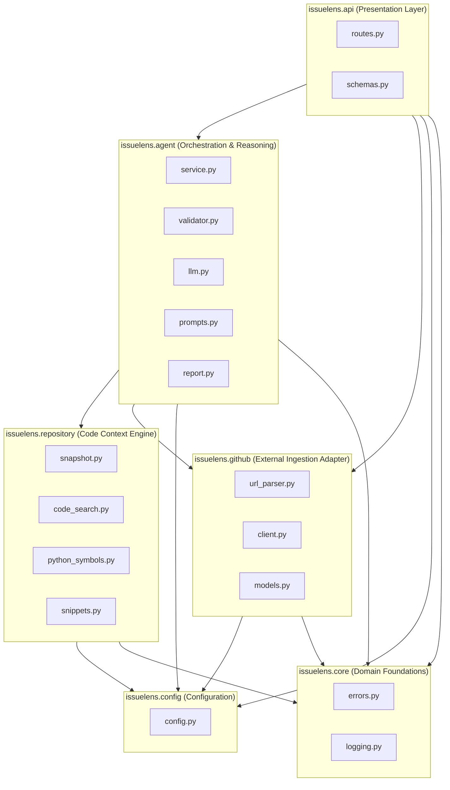

# Codebase Map & Package Boundaries

This document maps the IssueLens repository structure, illustrating the dependencies between internal packages, key symbols, data models, and providing a newcomer-friendly guide on where to look when modifying specific behaviors.

---

## 1. Package Dependency Architecture

IssueLens enforces strict layered architecture principles. Lower-level domain packages (`core`, `config`) have zero knowledge of higher-level adapters (`github`, `repository`, `agent`, `api`):



### Architectural Layering Rules
1. **`issuelens.core` is a leaf**: It never imports from any other `issuelens.*` module. It defines domain exceptions and logging infrastructure.
2. **`issuelens.config` is a leaf**: It loads and validates environment variables. It never imports application domain logic.
3. **`issuelens.github` and `issuelens.repository` are independent**: Neither package imports the other. The `agent` layer connects repository snapshots with GitHub issue contexts.
4. **Protocols over Concretions**: High-level modules depend on structural protocols ([`GitHubClientProtocol`](file:///c:/Projects/Issuelens/src/issuelens/github/client.py#L32), [`LLMClientProtocol`](file:///c:/Projects/Issuelens/src/issuelens/agent/llm.py#L23)) rather than concrete network implementations, enabling clean mock injection.

---

## 2. Directory Layout & Key Symbols

```text
issuelens/
├── pyproject.toml              # Build backend (Hatchling), dependencies, Ruff & Mypy configs
├── README.md                   # Project overview, quickstart, and developer setup
├── AGENTS.md                   # Operational rules for coding assistants and agents
├── docs/                       # Project specifications, learning guide, and architecture
│   ├── BUILD_SPECIFICATION.md  # Master product build specification
│   ├── BUILD_LOG.md            # Verified bug root causes, fixes, and engineering lessons
│   ├── LEARNING_GUIDE.md       # Pedagogical walkthrough for junior engineers
│   ├── architecture/           # System architecture diagrams and specifications
│   └── decisions/              # Numbered Architecture Decision Records (ADRs)
├── src/
│   └── issuelens/
│       ├── __init__.py         # Package root, exports __version__ = "0.1.0"
│       ├── main.py             # FastAPI entrypoint, lifespan manager, error handler
│       ├── config.py           # Pydantic Settings and environment configuration
│       ├── api/                # HTTP REST presentation layer
│       ├── core/               # Shared domain errors and logging filters
│       ├── github/             # GitHub REST API adapter and URL parser
│       ├── repository/         # Repository snapshot manager, code search, AST
│       └── agent/              # Investigation service, LLM client, and validator
└── tests/
    ├── unit/                   # 124 hermetic unit and integration tests
    └── fixtures/               # Offline test repositories and broken code fixtures
```

### Module Reference Directory

| Package / Module | Key Classes & Functions | Responsibility |
| :--- | :--- | :--- |
| [`src/issuelens/config.py`](file:///c:/Projects/Issuelens/src/issuelens/config.py) | [`Settings`](file:///c:/Projects/Issuelens/src/issuelens/config.py#L12), [`get_settings()`](file:///c:/Projects/Issuelens/src/issuelens/config.py#L40) | Strongly-typed configuration loaded from `.env` or system environment. |
| [`src/issuelens/main.py`](file:///c:/Projects/Issuelens/src/issuelens/main.py) | [`create_app()`](file:///c:/Projects/Issuelens/src/issuelens/main.py#L33), [`lifespan()`](file:///c:/Projects/Issuelens/src/issuelens/main.py#L19), `issuelens_exception_handler` | FastAPI app factory, lifespan logging lifecycle, and global exception translation. |
| [`src/issuelens/api/routes.py`](file:///c:/Projects/Issuelens/src/issuelens/api/routes.py) | `get_health`, `get_readiness`, `ingest_issue`, `create_investigation`, `get_investigation_status` | REST API routes, dependency injection providers, and in-memory run registry. |
| [`src/issuelens/api/schemas.py`](file:///c:/Projects/Issuelens/src/issuelens/api/schemas.py) | `InvestigationCreateRequest`, `InvestigationStatusResponse`, `HealthResponse` | Pydantic DTO schemas for API request validation and response serialization. |
| [`src/issuelens/core/errors.py`](file:///c:/Projects/Issuelens/src/issuelens/core/errors.py) | [`IssueLensError`](file:///c:/Projects/Issuelens/src/issuelens/core/errors.py#L4), `InvalidInputError`, `SafetyViolationError`, `RateLimitExceededError` | Domain exception hierarchy carrying semantic error codes and HTTP status codes. |
| [`src/issuelens/core/logging.py`](file:///c:/Projects/Issuelens/src/issuelens/core/logging.py) | [`SecretRedactionFilter`](file:///c:/Projects/Issuelens/src/issuelens/core/logging.py#L18), [`setup_logging()`](file:///c:/Projects/Issuelens/src/issuelens/core/logging.py#L50), `get_logger` | Logging setup with regex filter scrubbing tokens, API keys, and Bearer headers. |
| [`src/issuelens/github/url_parser.py`](file:///c:/Projects/Issuelens/src/issuelens/github/url_parser.py) | [`parse_issue_target()`](file:///c:/Projects/Issuelens/src/issuelens/github/url_parser.py#L37), [`IssueTarget`](file:///c:/Projects/Issuelens/src/issuelens/github/url_parser.py#L18) | URL parsing, `https://github.com` host allowlisting, and PR rejection. |
| [`src/issuelens/github/client.py`](file:///c:/Projects/Issuelens/src/issuelens/github/client.py) | [`GitHubClient`](file:///c:/Projects/Issuelens/src/issuelens/github/client.py#L64), [`GitHubClientProtocol`](file:///c:/Projects/Issuelens/src/issuelens/github/client.py#L32), `FakeGitHubClient` | Async HTTP client fetching issues, comments, metadata, and streaming zipballs. |
| [`src/issuelens/github/models.py`](file:///c:/Projects/Issuelens/src/issuelens/github/models.py) | [`GitHubIssueContext`](file:///c:/Projects/Issuelens/src/issuelens/github/models.py#L79), [`GitHubIssue`](file:///c:/Projects/Issuelens/src/issuelens/github/models.py#L12), [`GitHubRepo`](file:///c:/Projects/Issuelens/src/issuelens/github/models.py#L58) | Typed Pydantic representations of GitHub entities and resolved commit SHAs. |
| [`src/issuelens/repository/snapshot.py`](file:///c:/Projects/Issuelens/src/issuelens/repository/snapshot.py) | [`RepoSnapshot`](file:///c:/Projects/Issuelens/src/issuelens/repository/snapshot.py#L74), [`cache_and_create_snapshot_from_zip()`](file:///c:/Projects/Issuelens/src/issuelens/repository/snapshot.py#L305), `prune_snapshot_cache` | Path traversal defense, commit-pinned disk cache, atomic staging, and LRU pruning. |
| [`src/issuelens/repository/code_search.py`](file:///c:/Projects/Issuelens/src/issuelens/repository/code_search.py) | [`search_code()`](file:///c:/Projects/Issuelens/src/issuelens/repository/code_search.py#L150), `find_ripgrep_executable`, `_search_with_python`, [`CodeHit`](file:///c:/Projects/Issuelens/src/issuelens/repository/code_search.py#L23) | Dual-engine lexical code search with automatic fallback and AST symbol enrichment. |
| [`src/issuelens/repository/python_symbols.py`](file:///c:/Projects/Issuelens/src/issuelens/repository/python_symbols.py) | [`parse_python_symbols()`](file:///c:/Projects/Issuelens/src/issuelens/repository/python_symbols.py#L107), `find_enclosing_symbol` | Pure AST visitor extracting classes and functions with 1-indexed line spans without execution. |
| [`src/issuelens/repository/snippets.py`](file:///c:/Projects/Issuelens/src/issuelens/repository/snippets.py) | [`read_snippet()`](file:///c:/Projects/Issuelens/src/issuelens/repository/snippets.py#L7) | Safe line-numbered snippet extractor with boundary clamping and context padding. |
| [`src/issuelens/agent/service.py`](file:///c:/Projects/Issuelens/src/issuelens/agent/service.py) | [`InvestigationService`](file:///c:/Projects/Issuelens/src/issuelens/agent/service.py#L70), `compile_search_query` | Orchestrator connecting GitHub context, snapshot cache, search, LLM, and validator. |
| [`src/issuelens/agent/llm.py`](file:///c:/Projects/Issuelens/src/issuelens/agent/llm.py) | [`LangChainLLMClient`](file:///c:/Projects/Issuelens/src/issuelens/agent/llm.py#L35), [`LLMClientProtocol`](file:///c:/Projects/Issuelens/src/issuelens/agent/llm.py#L23), [`MockLLMClient`](file:///c:/Projects/Issuelens/src/issuelens/agent/llm.py#L87) | LangChain chat model wrapper enforcing Pydantic structured output. |
| [`src/issuelens/agent/prompts.py`](file:///c:/Projects/Issuelens/src/issuelens/agent/prompts.py) | `SYSTEM_PROMPT`, [`build_investigation_messages()`](file:///c:/Projects/Issuelens/src/issuelens/agent/prompts.py#L125), `format_evidence_block` | Anti-injection prompt builder wrapping untrusted external data in XML enclaves. |
| [`src/issuelens/agent/report.py`](file:///c:/Projects/Issuelens/src/issuelens/agent/report.py) | [`InvestigationReport`](file:///c:/Projects/Issuelens/src/issuelens/agent/report.py#L126), [`Hypothesis`](file:///c:/Projects/Issuelens/src/issuelens/agent/report.py#L51), [`EvidenceItem`](file:///c:/Projects/Issuelens/src/issuelens/agent/report.py#L12), `InvestigationReportPayload` | Domain models for evidence, hypotheses, and reports with provenance binding. |
| [`src/issuelens/agent/validator.py`](file:///c:/Projects/Issuelens/src/issuelens/agent/validator.py) | [`validate_citation()`](file:///c:/Projects/Issuelens/src/issuelens/agent/validator.py#L109), [`validate_investigation_report()`](file:///c:/Projects/Issuelens/src/issuelens/agent/validator.py#L257) | Deterministic citation validator, ungrounded hypothesis demoter, and insufficient evidence fallback. |

---

## 3. "Where to Look" Guide for Common Changes

When tasked with altering or extending IssueLens behavior, consult this lookup table:

| Developer Goal | Primary File(s) to Modify | Key Classes / Functions | What to Keep in Mind |
| :--- | :--- | :--- | :--- |
| **Add a new REST API endpoint** | [`src/issuelens/api/routes.py`](file:///c:/Projects/Issuelens/src/issuelens/api/routes.py), [`src/issuelens/api/schemas.py`](file:///c:/Projects/Issuelens/src/issuelens/api/schemas.py) | Router decorators, `Depends(...)` | Use `typing.Annotated` for dependencies to avoid Ruff `B008`. Update [`tests/unit/test_issue_api.py`](file:///c:/Projects/Issuelens/tests/unit/test_issue_api.py). |
| **Change lexical code search ranking or scoring** | [`src/issuelens/repository/code_search.py`](file:///c:/Projects/Issuelens/src/issuelens/repository/code_search.py) | `search_code()`, `_rank_hits()` | Changes must be applied identically to both ripgrep JSON parsing and the Python fallback engine. |
| **Add new excluded file patterns (e.g., secrets, test dumps)** | [`src/issuelens/repository/snapshot.py`](file:///c:/Projects/Issuelens/src/issuelens/repository/snapshot.py) | `is_path_excluded()`, `DEFAULT_EXCLUDED_PATTERNS` | Ensure exclusion patterns block files from both search indexing and snapshot file listings. |
| **Adjust snapshot cache storage limits** | [`src/issuelens/config.py`](file:///c:/Projects/Issuelens/src/issuelens/config.py), [`.env.example`](file:///c:/Projects/Issuelens/.env.example) | `Settings.max_cached_snapshots`, `Settings.max_cache_total_bytes` | Document defaults in `.env.example`. Test via [`tests/unit/test_snapshot_cache.py`](file:///c:/Projects/Issuelens/tests/unit/test_snapshot_cache.py). |
| **Modify prompt engineering or injection defenses** | [`src/issuelens/agent/prompts.py`](file:///c:/Projects/Issuelens/src/issuelens/agent/prompts.py) | `SYSTEM_PROMPT`, `build_investigation_messages()` | Always preserve XML boundary tags `<untrusted_issue_data>`. Do not remove the strict prohibition against claiming tests passed. |
| **Tweak citation verification or excerpt matching rules** | [`src/issuelens/agent/validator.py`](file:///c:/Projects/Issuelens/src/issuelens/agent/validator.py) | `validate_citation()`, `excerpts_match()` | Keep string normalization whitespace-agnostic. Never permit path traversals (`../`). |
| **Add a new LLM provider (e.g. Google Gemini, Mistral)** | [`src/issuelens/agent/llm.py`](file:///c:/Projects/Issuelens/src/issuelens/agent/llm.py), [`src/issuelens/config.py`](file:///c:/Projects/Issuelens/src/issuelens/config.py) | `create_langchain_chat_model()` | Must support LangChain's `.with_structured_output()`. Ensure auth errors map to [`SafetyViolationError`](file:///c:/Projects/Issuelens/src/issuelens/core/errors.py#L43). |
| **Add a new domain exception** | [`src/issuelens/core/errors.py`](file:///c:/Projects/Issuelens/src/issuelens/core/errors.py) | `IssueLensError` subclasses | Provide default `code` and explicit `status_code` so `main.py` exception handler emits accurate HTTP status. |

