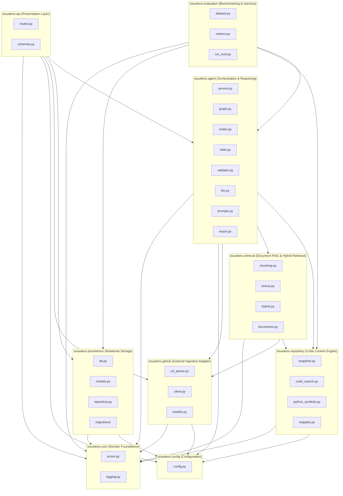

# Codebase Map & Package Boundaries

This document maps the IssueLens repository structure, illustrating the dependencies between internal packages, key symbols, data models, and providing a newcomer-friendly guide on where to look when modifying specific behaviors.

---

## 1. Package Dependency Architecture

IssueLens enforces strict layered architecture principles. Lower-level domain packages (`core`, `config`) have zero knowledge of higher-level adapters (`github`, `repository`, `agent`, `api`):



### Architectural Layering Rules
1. **`issuelens.core` is a leaf**: It never imports from any other `issuelens.*` module. It defines domain exceptions and logging infrastructure.
2. **`issuelens.config` is a leaf**: It loads and validates environment variables. It never imports application domain logic.
3. **`issuelens.github` and `issuelens.repository` are independent**: Neither package imports the other. The `agent` layer connects repository snapshots with GitHub issue contexts.
4. **Protocols over Concretions**: High-level modules depend on structural protocols ([`GitHubClientProtocol`](../../src/issuelens/github/client.py#L32), [`LLMClientProtocol`](../../src/issuelens/agent/llm.py#L23)) rather than concrete network implementations, enabling clean mock injection.

---

## 2. Directory Layout & Key Symbols

```text
issuelens/
├── pyproject.toml              # Build backend (Hatchling), dependencies, Ruff & Mypy configs
├── README.md                   # Project overview, quickstart, and developer setup
├── AGENTS.md                   # Operational rules for coding assistants and agents
├── docs/                       # Project specifications, learning guide, and architecture
│   ├── BUILD_SPECIFICATION.md  # Master product build specification
│   ├── BUILD_LOG.md            # Verified bug root causes, fixes, and engineering lessons
│   ├── LEARNING_GUIDE.md       # Pedagogical walkthrough for junior engineers
│   ├── architecture/           # System architecture diagrams and specifications
│   └── decisions/              # Numbered Architecture Decision Records (ADRs)
├── evals/                      # Retrospective evaluation benchmark cases and guides
│   ├── cases.jsonl             # Curated public issue benchmark dataset (20 cases)
│   ├── README.md               # Benchmark rubric, leak prevention, and CLI guide
│   └── results.json            # Machine-readable evaluation run outputs
├── src/
│   └── issuelens/
│       ├── __init__.py         # Package root, exports __version__ = "0.1.0"
│       ├── main.py             # FastAPI entrypoint, lifespan manager, error handler
│       ├── config.py           # Pydantic Settings and environment configuration
│       ├── api/                # HTTP REST presentation layer
│       ├── core/               # Shared domain errors and logging filters
│       ├── github/             # GitHub REST API adapter and URL parser
│       ├── repository/         # Repository snapshot manager, code search, AST
│       ├── persistence/        # SQLAlchemy ORM models, async engine, migrations, repository
│       ├── evaluation/         # Retrospective benchmark dataset loader, metrics, and runner
│       └── agent/              # LangGraph workflow, nodes, state, LLM, and validator
└── tests/
    ├── unit/                   # 186 hermetic unit and integration tests
    └── fixtures/               # Offline test repositories and broken code fixtures
```

### Module Reference Directory

| Package / Module | Key Classes & Functions | Responsibility |
| :--- | :--- | :--- |
| [`src/issuelens/config.py`](../../src/issuelens/config.py) | [`Settings`](../../src/issuelens/config.py#L12), [`get_settings()`](../../src/issuelens/config.py#L40) | Strongly-typed configuration loaded from `.env` or system environment. |
| [`src/issuelens/main.py`](../../src/issuelens/main.py) | [`create_app()`](../../src/issuelens/main.py#L33), [`lifespan()`](../../src/issuelens/main.py#L19), `issuelens_exception_handler` | FastAPI app factory, lifespan logging lifecycle, and global exception translation. |
| [`src/issuelens/api/routes.py`](../../src/issuelens/api/routes.py) | `get_health`, `get_readiness`, `ingest_issue`, `create_investigation`, `get_investigation_status` | REST API routes, dependency injection providers, and in-memory run registry. |
| [`src/issuelens/api/security.py`](../../src/issuelens/api/security.py) | `RateLimiter`, `verify_api_key`, `enforce_rate_limit`, `get_client_identifier` | API key token authentication, constant-time verification, and sliding-window rate limiting. |
| [`src/issuelens/api/schemas.py`](../../src/issuelens/api/schemas.py) | `InvestigationCreateRequest`, `InvestigationStatusResponse`, `HealthResponse` | Pydantic DTO schemas for API request validation and response serialization. |
| [`src/issuelens/core/errors.py`](../../src/issuelens/core/errors.py) | [`IssueLensError`](../../src/issuelens/core/errors.py#L4), `InvalidInputError`, `SafetyViolationError`, `RateLimitExceededError` | Domain exception hierarchy carrying semantic error codes and HTTP status codes. |
| [`src/issuelens/core/logging.py`](../../src/issuelens/core/logging.py) | [`SecretRedactionFilter`](../../src/issuelens/core/logging.py#L18), [`setup_logging()`](../../src/issuelens/core/logging.py#L50), `get_logger` | Logging setup with regex filter scrubbing tokens, API keys, and Bearer headers. |
| [`src/issuelens/github/url_parser.py`](../../src/issuelens/github/url_parser.py) | [`parse_issue_target()`](../../src/issuelens/github/url_parser.py#L37), [`IssueTarget`](../../src/issuelens/github/url_parser.py#L18) | URL parsing, `https://github.com` host allowlisting, and PR rejection. |
| [`src/issuelens/github/client.py`](../../src/issuelens/github/client.py) | [`GitHubClient`](../../src/issuelens/github/client.py#L64), [`GitHubClientProtocol`](../../src/issuelens/github/client.py#L32), `FakeGitHubClient` | Async HTTP client fetching issues, comments, metadata, and streaming zipballs. |
| [`src/issuelens/github/models.py`](../../src/issuelens/github/models.py) | [`GitHubIssueContext`](../../src/issuelens/github/models.py#L79), [`GitHubIssue`](../../src/issuelens/github/models.py#L12), [`GitHubRepo`](../../src/issuelens/github/models.py#L58) | Typed Pydantic representations of GitHub entities and resolved commit SHAs. |
| [`src/issuelens/repository/snapshot.py`](../../src/issuelens/repository/snapshot.py) | [`RepoSnapshot`](../../src/issuelens/repository/snapshot.py#L74), [`cache_and_create_snapshot_from_zip()`](../../src/issuelens/repository/snapshot.py#L305), `prune_snapshot_cache` | Path traversal defense, commit-pinned disk cache, atomic staging, and LRU pruning. |
| [`src/issuelens/repository/code_search.py`](../../src/issuelens/repository/code_search.py) | [`search_code()`](../../src/issuelens/repository/code_search.py), `select_search_terms`, `term_weight`, `classify_path`, `find_ripgrep_executable`, `_search_with_python_fallback`, [`CodeHit`](../../src/issuelens/repository/code_search.py) | Dual-engine lexical code search with deterministic relevance ranking, automatic fallback, AST symbol enrichment, and per-file result budgets. |
| [`src/issuelens/repository/python_symbols.py`](../../src/issuelens/repository/python_symbols.py) | [`parse_python_symbols()`](../../src/issuelens/repository/python_symbols.py#L107), `find_enclosing_symbol` | Pure AST visitor extracting classes and functions with 1-indexed line spans without execution. |
| [`src/issuelens/repository/snippets.py`](../../src/issuelens/repository/snippets.py) | [`read_snippet()`](../../src/issuelens/repository/snippets.py#L7), [`read_snippet_with_bounds()`](../../src/issuelens/repository/snippets.py) | Safe line-numbered snippet extractor with boundary clamping, context padding, and bounds verification. |
| [`src/issuelens/retrieval/chunking.py`](../../src/issuelens/retrieval/chunking.py) | `DocumentChunk`, `chunk_markdown`, `chunk_issue_context` | Heading-preserving markdown and issue text chunker with 1-indexed line spans and SHA-256 hashes. |
| [`src/issuelens/retrieval/lexical.py`](../../src/issuelens/retrieval/lexical.py) | `BM25Index`, `tokenize`, `DEFAULT_STOP_WORDS` | Deterministic Okapi BM25 index with Robertson-Spärck Jones IDF and term saturation parameters. |
| [`src/issuelens/retrieval/hybrid.py`](../../src/issuelens/retrieval/hybrid.py) | `HybridSearchEngine`, `DenseEmbedderProtocol`, `reciprocal_rank_fusion` | Reciprocal Rank Fusion (k=60) combining lexical BM25 and dense vector rankings with safe fallback. |
| [`src/issuelens/retrieval/documents.py`](../../src/issuelens/retrieval/documents.py) | `DocumentRetriever` | Repository snapshot documentation discoverer, index builder, and EvidenceItem generator. |
| [`src/issuelens/persistence/models.py`](../../src/issuelens/persistence/models.py) | `Base`, `InvestigationRun`, `EvidenceItem`, `Hypothesis`, `InvestigationReportRecord`, `EvaluationCase`, `EvaluationResult` | Declarative SQLAlchemy 2.0 ORM models mapping relational tables and cascading foreign keys. |
| [`src/issuelens/persistence/db.py`](../../src/issuelens/persistence/db.py) | `init_engine`, `get_engine`, `get_session_factory`, `get_db_session`, `check_database_health`, `create_all_tables` | Async database engine manager, session lifecycle, connection string normalizer, and `/readyz` health probe. |
| [`src/issuelens/persistence/repository.py`](../../src/issuelens/persistence/repository.py) | `InvestigationRepositoryProtocol`, `SQLAlchemyInvestigationRepository` | Domain repository handling transactional persistence of runs, reports, evidence items, and hypotheses. |
| [`src/issuelens/persistence/migrations/`](../../src/issuelens/persistence/migrations/) | `001_initial_schema.py`, `env.py`, `script.py.mako` | Alembic async database migration environment and migration revisions. |
| [`src/issuelens/agent/service.py`](../../src/issuelens/agent/service.py) | [`InvestigationService`](../../src/issuelens/agent/service.py#L70), `compile_search_query` | Orchestrator connecting GitHub context, snapshot cache, search, LLM, and validator. |
| [`src/issuelens/agent/graph.py`](../../src/issuelens/agent/graph.py) | `create_investigation_graph` | Compiled multi-round LangGraph state machine with cyclic follow-up retrieval and loop caps. |
| [`src/issuelens/agent/nodes.py`](../../src/issuelens/agent/nodes.py) | `InvestigationNodes`, `decide_next_step` | Discrete workflow nodes (`parse_issue`, `retrieve_initial`, `form_hypotheses`, `evaluate_evidence`, `retrieve_followup`, `validate_citations`, `build_report`). |
| [`src/issuelens/agent/state.py`](../../src/issuelens/agent/state.py) | `InvestigationState`, `ToolTraceItem`, `IssueSummary` | Typed dictionary schemas for immutable workflow state and audit tool traces. |
| [`src/issuelens/agent/llm.py`](../../src/issuelens/agent/llm.py) | [`LangChainLLMClient`](../../src/issuelens/agent/llm.py#L35), [`LLMClientProtocol`](../../src/issuelens/agent/llm.py#L23), [`MockLLMClient`](../../src/issuelens/agent/llm.py#L87) | LangChain chat model wrapper enforcing Pydantic structured output. |
| [`src/issuelens/agent/prompts.py`](../../src/issuelens/agent/prompts.py) | `SYSTEM_PROMPT`, [`build_investigation_messages()`](../../src/issuelens/agent/prompts.py#L125), `format_evidence_block` | Anti-injection prompt builder wrapping untrusted external data in XML enclaves. |
| [`src/issuelens/agent/report.py`](../../src/issuelens/agent/report.py) | [`InvestigationReport`](../../src/issuelens/agent/report.py#L126), [`Hypothesis`](../../src/issuelens/agent/report.py#L51), [`EvidenceItem`](../../src/issuelens/agent/report.py#L12), `InvestigationReportPayload` | Domain models for evidence, hypotheses, and reports with provenance binding. |
| [`src/issuelens/agent/validator.py`](../../src/issuelens/agent/validator.py) | [`validate_citation()`](../../src/issuelens/agent/validator.py#L109), [`validate_investigation_report()`](../../src/issuelens/agent/validator.py#L257) | Deterministic citation validator, ungrounded hypothesis demoter, and insufficient evidence fallback. |
| [`src/issuelens/evaluation/dataset.py`](../../src/issuelens/evaluation/dataset.py) | `EvaluationCaseModel`, `EvaluationDataset`, `load_evaluation_cases`, `save_evaluation_cases` | Dataset models and JSON Lines parser enforcing pre-fix commit pinning and leak prevention. |
| [`src/issuelens/evaluation/metrics.py`](../../src/issuelens/evaluation/metrics.py) | `compute_citation_validity`, `compute_recall_at_k`, `compute_unsupported_claims`, `aggregate_evaluation_metrics` | Deterministic evaluator computing validity rates, Recall@k, Hit@k, and claim grounding. |
| [`src/issuelens/evaluation/run_eval.py`](../../src/issuelens/evaluation/run_eval.py) | `EvaluationRunner`, `run_evaluation`, `format_evaluation_summary`, `main` | CLI orchestration runner evaluating benchmark cases, formatting summaries, and saving JSON results. |
| [`evals/cases.jsonl`](../../evals/cases.jsonl) | `CASE-001` .. `CASE-020` | Curated public Python issue benchmark dataset with withheld resolutions. |

---

## 3. "Where to Look" Guide for Common Changes

When tasked with altering or extending IssueLens behavior, consult this lookup table:

| Developer Goal | Primary File(s) to Modify | Key Classes / Functions | What to Keep in Mind |
| :--- | :--- | :--- | :--- |
| **Add a new REST API endpoint** | [`src/issuelens/api/routes.py`](../../src/issuelens/api/routes.py), [`src/issuelens/api/schemas.py`](../../src/issuelens/api/schemas.py) | Router decorators, `Depends(...)` | Use `typing.Annotated` for dependencies to avoid Ruff `B008`. Update [`tests/unit/test_issue_api.py`](../../tests/unit/test_issue_api.py). |
| **Change lexical code search ranking or scoring** | [`src/issuelens/repository/code_search.py`](../../src/issuelens/repository/code_search.py) | `search_code()`, `select_search_terms()`, `_file_priority()` | Changes must be applied identically to both ripgrep JSON parsing and the Python fallback engine. Ranking policy is recorded in ADR-006. |
| **Add new excluded file patterns (e.g., secrets, test dumps)** | [`src/issuelens/repository/snapshot.py`](../../src/issuelens/repository/snapshot.py) | `is_path_excluded()`, `DEFAULT_EXCLUDED_PATTERNS` | Ensure exclusion patterns block files from both search indexing and snapshot file listings. |
| **Adjust snapshot cache storage limits** | [`src/issuelens/config.py`](../../src/issuelens/config.py), [`.env.example`](../../.env.example) | `Settings.max_cached_snapshots`, `Settings.max_cache_total_bytes` | Document defaults in `.env.example`. Test via [`tests/unit/test_snapshot_cache.py`](../../tests/unit/test_snapshot_cache.py). |
| **Modify prompt engineering or injection defenses** | [`src/issuelens/agent/prompts.py`](../../src/issuelens/agent/prompts.py) | `SYSTEM_PROMPT`, `build_investigation_messages()` | Always preserve XML boundary tags `<untrusted_issue_data>`. Do not remove the strict prohibition against claiming tests passed. |
| **Tweak citation verification or excerpt matching rules** | [`src/issuelens/agent/validator.py`](../../src/issuelens/agent/validator.py) | `validate_citation()`, `excerpts_match()` | Keep string normalization whitespace-agnostic. Never permit path traversals (`../`). |
| **Modify database schema or persist new fields** | [`src/issuelens/retrieval/chunking.py`](../../src/issuelens/retrieval/chunking.py) | `DocumentChunk`, `chunk_markdown`, `chunk_issue_context` | Heading-preserving markdown and issue text chunker with 1-indexed line spans and SHA-256 hashes. |
| [`src/issuelens/retrieval/lexical.py`](../../src/issuelens/retrieval/lexical.py) | `BM25Index`, `tokenize`, `DEFAULT_STOP_WORDS` | Deterministic Okapi BM25 index with Robertson-Spärck Jones IDF and term saturation parameters. |
| [`src/issuelens/retrieval/hybrid.py`](../../src/issuelens/retrieval/hybrid.py) | `HybridSearchEngine`, `DenseEmbedderProtocol`, `reciprocal_rank_fusion` | Reciprocal Rank Fusion (k=60) combining lexical BM25 and dense vector rankings with safe fallback. |
| [`src/issuelens/retrieval/documents.py`](../../src/issuelens/retrieval/documents.py) | `DocumentRetriever` | Repository snapshot documentation discoverer, index builder, and EvidenceItem generator. |
| [`src/issuelens/persistence/models.py`](../../src/issuelens/persistence/models.py), [`src/issuelens/persistence/repository.py`](../../src/issuelens/persistence/repository.py) | `InvestigationRun`, `SQLAlchemyInvestigationRepository` | Create Alembic migration in `src/issuelens/persistence/migrations/versions/`. Update repository methods and verify with [`tests/unit/test_persistence.py`](../../tests/unit/test_persistence.py). |
| **Add a new LLM provider (e.g. Google Gemini, Mistral)** | [`src/issuelens/agent/llm.py`](../../src/issuelens/agent/llm.py), [`src/issuelens/config.py`](../../src/issuelens/config.py) | `create_langchain_chat_model()` | Must support LangChain's `.with_structured_output()`. Ensure auth errors map to [`SafetyViolationError`](../../src/issuelens/core/errors.py#L43). |
| **Add a new domain exception** | [`src/issuelens/core/errors.py`](../../src/issuelens/core/errors.py) | `IssueLensError` subclasses | Provide default `code` and explicit `status_code` so `main.py` exception handler emits accurate HTTP status. |
| **Add a new evaluation benchmark case** | [`evals/cases.jsonl`](../../evals/cases.jsonl), [`src/issuelens/evaluation/dataset.py`](../../src/issuelens/evaluation/dataset.py) | `EvaluationCaseModel` | Ensure `target_commit_sha` is 40-char pre-fix commit. Expected files must be relative paths. Verify with `test_eval_dataset.py`. |
| **Calibrate or add evaluation metrics** | [`src/issuelens/evaluation/metrics.py`](../../src/issuelens/evaluation/metrics.py) | `compute_evaluation_metrics()`, `aggregate_evaluation_metrics()` | Keep metric functions deterministic. Update benchmarks in `testing-and-evaluation.md` and test in `test_eval_metrics.py`. |

