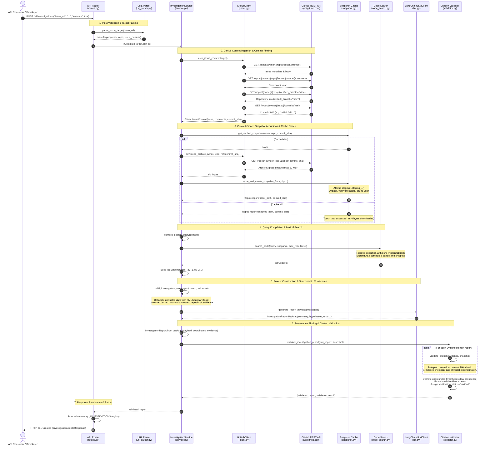
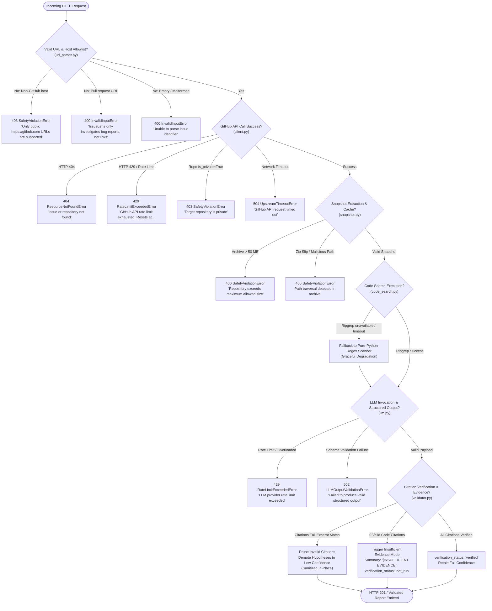

# Request Lifecycle & Execution Paths

This document provides a detailed end-to-end trace of an IssueLens investigation request, illustrating the complete control flow, data transformations, security gates, and failure pathways from initial URL submission to delivery of a verified investigation report.

---

## 1. Successful Request Sequence (Happy Path)

The following sequence diagram details the synchronous execution path when a client requests an investigation via `POST /v1/investigations` with `execute=true`:



---

## 2. Detailed Execution Stages

| Stage | Component | Actions Performed | Primary Outputs |
| :--- | :--- | :--- | :--- |
| **1. Input Ingress** | [`src/issuelens/api/routes.py`](file:///c:/Projects/Issuelens/src/issuelens/api/routes.py) | Endpoint receives payload, validates JSON types with Pydantic [`InvestigationCreateRequest`](file:///c:/Projects/Issuelens/src/issuelens/api/schemas.py#L32), and assigns correlation IDs. | Validated request object. |
| **2. Target Parsing** | [`src/issuelens/github/url_parser.py`](file:///c:/Projects/Issuelens/src/issuelens/github/url_parser.py) | Normalizes input, verifies `https://github.com` host allowlist, rejects `/pull/` paths, and parses `owner/repo#number`. | Immutable [`IssueTarget`](file:///c:/Projects/Issuelens/src/issuelens/github/url_parser.py#L18). |
| **3. GitHub Ingestion** | [`src/issuelens/github/client.py`](file:///c:/Projects/Issuelens/src/issuelens/github/client.py) | Fetches issue body, pagination comments, checks repository public visibility, and resolves default branch head to stable commit SHA. | [`GitHubIssueContext`](file:///c:/Projects/Issuelens/src/issuelens/github/models.py#L79). |
| **4. Snapshot Retrieval** | [`src/issuelens/repository/snapshot.py`](file:///c:/Projects/Issuelens/src/issuelens/repository/snapshot.py) | Queries commit-pinned cache (`.cache/issuelens/snapshots/`). On miss: streams archive from GitHub API, extracts atomically, and prunes LRU snapshots. | Verified [`RepoSnapshot`](file:///c:/Projects/Issuelens/src/issuelens/repository/snapshot.py#L74). |
| **5. Code Search** | [`src/issuelens/repository/code_search.py`](file:///c:/Projects/Issuelens/src/issuelens/repository/code_search.py) | Extracts search tokens, executes ripgrep (or Python regex scanner fallback), expands matches to enclosing AST symbols, and formats line-numbered snippets. | Ranked `list[CodeHit]`. |
| **6. Prompt Assembly** | [`src/issuelens/agent/prompts.py`](file:///c:/Projects/Issuelens/src/issuelens/agent/prompts.py) | Wraps untrusted issue text and code snippets into XML boundary tags (`<untrusted_issue_data>`), attaching strict anti-injection system directives. | LangChain message list (`SystemMessage`, `HumanMessage`). |
| **7. Structured LLM Call** | [`src/issuelens/agent/llm.py`](file:///c:/Projects/Issuelens/src/issuelens/agent/llm.py) | Invokes provider chat model using `.with_structured_output(InvestigationReportPayload)`, converting vendor errors into typed domain exceptions. | Structured [`InvestigationReportPayload`](file:///c:/Projects/Issuelens/src/issuelens/agent/report.py#L87). |
| **8. Citation Validation** | [`src/issuelens/agent/validator.py`](file:///c:/Projects/Issuelens/src/issuelens/agent/validator.py) | Binds report to immutable git provenance, verifies citations line-by-line against snapshot files on disk, prunes invalid evidence, demotes ungrounded hypotheses, and computes verification status. | Fully verified [`InvestigationReport`](file:///c:/Projects/Issuelens/src/issuelens/agent/report.py#L126). |
| **9. Response Delivery** | [`src/issuelens/api/routes.py`](file:///c:/Projects/Issuelens/src/issuelens/api/routes.py) | Records investigation run in `_INVESTIGATIONS` registry and formats HTTP response. | HTTP 201 Created JSON response. |

---

## 3. Failure Paths & Error Recovery

IssueLens incorporates defensive runtime controls at every boundary. The flowchart below maps how anomalous inputs and upstream failures are detected, isolated, and translated into meaningful client error responses:



---

## 4. Key Failure Scenarios & Error Contract

All failure paths emit standardized, machine-readable JSON payloads conforming to the application error contract:

```json
{
  "error": {
    "code": "RATE_LIMIT_EXCEEDED",
    "message": "GitHub API rate limit exhausted. Resets at 2026-10-29T18:30:00Z.",
    "details": {
      "rate_limit_reset": "2026-10-29T18:30:00Z"
    }
  }
}
```

### Handled Error Taxonomy

| Exception Class | HTTP Status | Domain Code | Trigger Condition |
| :--- | :--- | :--- | :--- |
| [`InvalidInputError`](file:///c:/Projects/Issuelens/src/issuelens/core/errors.py#L27) | `400 Bad Request` | `INVALID_INPUT` | Malformed URL, negative issue number, or pull request coordinate submitted. |
| [`SafetyViolationError`](file:///c:/Projects/Issuelens/src/issuelens/core/errors.py#L43) | `403 Forbidden` / `400` | `SAFETY_VIOLATION` | SSRF attempt, non-GitHub host, private repository detected, or path traversal (`../`) attempt. |
| [`ResourceNotFoundError`](file:///c:/Projects/Issuelens/src/issuelens/core/errors.py#L35) | `404 Not Found` | `RESOURCE_NOT_FOUND` | GitHub issue does not exist, repository is missing, or run ID is not found in registry. |
| [`RateLimitExceededError`](file:///c:/Projects/Issuelens/src/issuelens/core/errors.py#L51) | `429 Too Many Requests` | `RATE_LIMIT_EXCEEDED` | Upstream GitHub API quota or LLM provider concurrency limit exhausted. |
| [`UpstreamTimeoutError`](file:///c:/Projects/Issuelens/src/issuelens/core/errors.py#L59) | `504 Gateway Timeout` | `UPSTREAM_TIMEOUT` | Upstream GitHub REST API or LLM provider failed to respond within `request_timeout_seconds`. |
| [`LLMOutputValidationError`](file:///c:/Projects/Issuelens/src/issuelens/core/errors.py#L67) | `502 Bad Gateway` | `LLM_VALIDATION_ERROR` | LLM model output failed Pydantic schema validation or produced unparseable JSON. |
