# System Overview

This document presents the high-level architecture of IssueLens, detailing the primary system components, their relationships, interfaces, data exchanges, and operational boundaries.

---

## 1. High-Level Component Diagram

The following diagram maps the entire IssueLens architecture, distinguishing between **implemented components** (active in Phases 0–4) and **planned components** (Phases 5–9):

```mermaid
flowchart TD
    User(["Developer / API Client"])

    subgraph EntryPoint["1. API Entry Point (Implemented)"]
        FastAPIApp["FastAPI Application<br/><code>src/issuelens/main.py</code>"]
        APIRouter["API Routes & Endpoints<br/><code>src/issuelens/api/routes.py</code>"]
        HealthProbes["Health & Readiness Probes<br/><code>/healthz, /readyz</code>"]
        ErrorHandlers["Domain Exception Handler<br/><code>issuelens_exception_handler()</code>"]
        FastAPIApp --> APIRouter
        APIRouter --> HealthProbes
        APIRouter --> ErrorHandlers
    end

    subgraph IngestionBoundary["2. GitHub Target Ingestion (Implemented)"]
        URLParser["URL & Coordinate Parser<br/><code>parse_issue_target()</code><br/><code>src/issuelens/github/url_parser.py</code>"]
        GitHubClient["Async GitHub REST Adapter<br/><code>GitHubClient</code> (Protocol-based)<br/><code>src/issuelens/github/client.py</code>"]
        GitHubModels["Typed Domain DTOs<br/><code>GitHubIssueContext</code><br/><code>src/issuelens/github/models.py</code>"]
        URLParser --> GitHubClient
        GitHubClient --> GitHubModels
    end

    subgraph RepoContext["3. Repository & Code Context Retrieval (Implemented)"]
        SnapshotManager["Snapshot Provider & Bounded Cache<br/><code>RepoSnapshot</code>, LRU Pruner<br/><code>src/issuelens/repository/snapshot.py</code>"]
        CodeSearch["Dual-Engine Lexical Search<br/>Ripgrep + Pure Python Fallback<br/><code>src/issuelens/repository/code_search.py</code>"]
        ASTSymbols["AST Python Symbol Parser<br/><code>parse_python_symbols()</code> (No eval)<br/><code>src/issuelens/repository/python_symbols.py</code>"]
        SnippetReader["Safe Line Snippet Extractor<br/><code>read_snippet()</code><br/><code>src/issuelens/repository/snippets.py</code>"]
        SnapshotManager --> CodeSearch
        CodeSearch --> ASTSymbols
        CodeSearch --> SnippetReader
    end

    subgraph AgentOrchestration["4. Agent Orchestration & LangGraph Workflow (Implemented)"]
        ServiceOrchestrator["Investigation Service<br/><code>InvestigationService.investigate()</code><br/><code>src/issuelens/agent/service.py</code>"]
        LangGraphEngine["LangGraph State Machine<br/><code>create_investigation_graph()</code><br/><code>src/issuelens/agent/graph.py</code>"]
        GraphNodes["Discrete Graph Nodes<br/><code>parse_issue, retrieve_initial, form_hypotheses...</code><br/><code>src/issuelens/agent/nodes.py</code>"]
        PromptBuilder["Prompt Enclave Builder<br/>XML Injection Defense<br/><code>src/issuelens/agent/prompts.py</code>"]
        LLMAdapter["LangChain LLM Adapter<br/><code>LangChainLLMClient</code><br/><code>src/issuelens/agent/llm.py</code>"]
        ServiceOrchestrator --> LangGraphEngine
        LangGraphEngine --> GraphNodes
        GraphNodes --> PromptBuilder
        PromptBuilder --> LLMAdapter
    end

    subgraph EvidenceValidation["5. Evidence Validation & Citation Guardrails (Implemented)"]
        CitationValidator["Deterministic Citation Validator<br/><code>validate_citation()</code><br/><code>src/issuelens/agent/validator.py</code>"]
        ReportSanitizer["Hypothesis Demotion & Insufficient Evidence<br/><code>validate_investigation_report()</code><br/><code>src/issuelens/agent/validator.py</code>"]
        ReportModels["Structured Report Schema<br/><code>InvestigationReport</code><br/><code>src/issuelens/agent/report.py</code>"]
        CitationValidator --> ReportSanitizer
        ReportSanitizer --> ReportModels
    end

    subgraph StateStorage["6. Relational Persistence & State (Implemented Phase 6)"]
        PostgresDB[("PostgreSQL Database<br/>Runs, Reports, Evidence, Hypotheses<br/><code>src/issuelens/persistence/</code>")]
        RepoLayer["Investigation Repository<br/><code>SQLAlchemyInvestigationRepository</code><br/><code>src/issuelens/persistence/repository.py</code>"]
        AlembicMigrations["Alembic Migrations<br/><code>001_initial_schema, 002_evidence_composite_key</code><br/><code>src/issuelens/persistence/migrations/</code>"]
        PostgresDB --> RepoLayer
        RepoLayer --> AlembicMigrations
    end

    subgraph EvaluationHarness["7. Evaluation Harness & Retrospective Benchmark (Phase 7)"]
        EvalRunner["Evaluation Runner CLI<br/><code>run_eval.py</code><br/><code>src/issuelens/evaluation/run_eval.py</code>"]
        BenchmarkDataset["Curated Benchmark Cases<br/><code>cases.jsonl</code> (20 cases)<br/><code>evals/cases.jsonl</code>"]
        MetricsEngine["Deterministic Evaluator<br/><code>metrics.py</code><br/><code>src/issuelens/evaluation/metrics.py</code>"]
        BenchmarkDataset --> EvalRunner
        EvalRunner --> MetricsEngine
    end

    subgraph DocumentRetrieval["8. Document RAG & Hybrid Retrieval (Implemented Phase 8)"]
        DocRetriever["Document Retriever<br/><code>DocumentRetriever</code><br/><code>src/issuelens/retrieval/documents.py</code>"]
        Chunker["Heading & Line Chunker<br/><code>chunk_markdown()</code><br/><code>src/issuelens/retrieval/chunking.py</code>"]
        BM25Engine["Okapi BM25 Lexical Engine<br/><code>BM25Index</code><br/><code>src/issuelens/retrieval/lexical.py</code>"]
        HybridEngine["BM25 Search<br/><code>HybridSearchEngine</code> (RRF/dense path inactive: no embedder)<br/><code>src/issuelens/retrieval/hybrid.py</code>"]
        DocRetriever --> Chunker
        DocRetriever --> HybridEngine
        HybridEngine --> BM25Engine
    end

    subgraph DeploymentHardening["9. Production Deployment & Security Hardening (Implemented Phase 9 & 10)"]
        DockerContainer["Multi-Stage Docker<br/>Non-root UID 1000 + Ripgrep<br/><code>Dockerfile</code>"]
        ComposeStack["Docker Compose Stack<br/>App + PostgreSQL 16 Alpine<br/><code>docker-compose.yml</code>"]
        APISecurity["API Security, Headers & Rate Limiting<br/>X-API-Key + Anti-Spoofing + Headers<br/><code>src/issuelens/api/security.py</code>"]
        ComposeStack --> DockerContainer
        APIRouter --> APISecurity
    end

    User -->|"POST /v1/investigations<br/>{issue_url}"| APIRouter
    APIRouter --> URLParser
    URLParser -->|"IssueTarget"| ServiceOrchestrator
    ServiceOrchestrator -->|"Fetch Context & Commit SHA"| GitHubClient
    GitHubClient -->|"External HTTPS (REST API)"| GitHubAPI[("GitHub REST API v3")]
    ServiceOrchestrator -->|"Acquire / Query Cache"| SnapshotManager
    SnapshotManager -->|"Disk Cache (.cache/issuelens/snapshots)"| DiskFS[("Local Disk Snapshot Cache")]
    ServiceOrchestrator -->|"Invoke State Machine"| LangGraphEngine
    GraphNodes -->|"Search Tokens"| CodeSearch
    SnippetReader -->|"CodeHit / EvidenceItem"| GraphNodes
    LLMAdapter -->|"Structured Output Request"| ExternalLLM[("External LLM Provider<br/>OpenAI / Anthropic")]
    LLMAdapter -->|"InvestigationReportPayload"| GraphNodes
    GraphNodes -->|"Validate Excerpts"| CitationValidator
    ReportSanitizer -->|"Validated InvestigationReport"| ServiceOrchestrator
    ServiceOrchestrator -->|"Final Report"| APIRouter
    APIRouter -->|"Store Run & Report"| RepoLayer
    RepoLayer -->|"Persist SQL"| PostgresDB
    APIRouter -->|"JSON Report"| User

    GraphNodes -->|"Search Query"| DocRetriever
    DocRetriever -->|"EvidenceItem (doc)"| GraphNodes
    EvalRunner -->|"Pin Pre-Fix Snapshot"| SnapshotManager
    EvalRunner -->|"Investigate Target"| ServiceOrchestrator
    EvalRunner -.->|"Persist Case & Result"| RepoLayer
```

---

## 2. Component Directory & Responsibilities

### 2.1 API Entry Point
- **Responsibility**: HTTP request ingress, correlation ID tracking, input schema validation, dependency injection, and centralized domain error handling.
- **Key Modules**:
  - [`src/issuelens/main.py`](../../src/issuelens/main.py): Application factory [`create_app()`](../../src/issuelens/main.py), lifespan logging manager, and global exception handler [`issuelens_exception_handler()`](../../src/issuelens/main.py).
  - [`src/issuelens/api/routes.py`](../../src/issuelens/api/routes.py): Endpoint declarations (`/healthz`, `/readyz`, `POST /v1/investigations`, `GET /v1/investigations/{run_id}`).
  - [`src/issuelens/api/schemas.py`](../../src/issuelens/api/schemas.py): Pydantic request and response transfer schemas.
- **Inputs**: HTTP REST requests (`issue_url`, execution flags).
- **Outputs**: HTTP JSON responses (`InvestigationStatusResponse`, `HealthResponse`, RFC-7807 compliant error schemas).

### 2.2 GitHub Target Ingestion
- **Responsibility**: Parse issue coordinates, defend against SSRF by allowlisting `github.com`, reject pull requests, fetch issue title/body/comments, and resolve the default branch head to a stable 40-character commit SHA.
- **Key Modules**:
  - [`src/issuelens/github/url_parser.py`](../../src/issuelens/github/url_parser.py): Pure function [`parse_issue_target()`](../../src/issuelens/github/url_parser.py) emitting immutable [`IssueTarget`](../../src/issuelens/github/url_parser.py).
  - [`src/issuelens/github/client.py`](../../src/issuelens/github/client.py): Asynchronous adapter [`GitHubClient`](../../src/issuelens/github/client.py) satisfying structural protocol [`GitHubClientProtocol`](../../src/issuelens/github/client.py).
  - [`src/issuelens/github/models.py`](../../src/issuelens/github/models.py): Strongly-typed domain models [`GitHubIssueContext`](../../src/issuelens/github/models.py), [`GitHubIssue`](../../src/issuelens/github/models.py), [`GitHubRepo`](../../src/issuelens/github/models.py).
- **Inputs**: Raw issue URL string or coordinate (`owner/repo#number`).
- **Outputs**: Verified [`GitHubIssueContext`](../../src/issuelens/github/models.py) containing pinned commit SHA and issue discussion comments.

### 2.3 Repository & Code Context Retrieval
- **Responsibility**: Safely download and extract commit-pinned repository archives, maintain a content-addressed snapshot cache with atomic staging and bounded LRU pruning, perform deterministic lexical searches (via ripgrep with pure-Python fallback), parse Python AST symbol spans without code execution, and format line-numbered code snippets.
- **Key Modules**:
  - [`src/issuelens/repository/snapshot.py`](../../src/issuelens/repository/snapshot.py): [`RepoSnapshot`](../../src/issuelens/repository/snapshot.py), containment checker [`safe_resolve()`](../../src/issuelens/repository/snapshot.py), [`cache_and_create_snapshot_from_zip()`](../../src/issuelens/repository/snapshot.py), and LRU cache pruner [`prune_snapshot_cache()`](../../src/issuelens/repository/snapshot.py).
  - [`src/issuelens/repository/code_search.py`](../../src/issuelens/repository/code_search.py): Lexical search engine [`search_code()`](../../src/issuelens/repository/code_search.py), [`find_ripgrep_executable()`](../../src/issuelens/repository/code_search.py), [`_search_with_python_fallback()`](../../src/issuelens/repository/code_search.py), and deterministic ranking helpers (`select_search_terms`, `term_weight`, `classify_path`).
  - [`src/issuelens/repository/python_symbols.py`](../../src/issuelens/repository/python_symbols.py): AST visitor [`_SymbolVisitor`](../../src/issuelens/repository/python_symbols.py) and symbol locator [`parse_python_symbols()`](../../src/issuelens/repository/python_symbols.py).
  - [`src/issuelens/repository/snippets.py`](../../src/issuelens/repository/snippets.py): Line-numbered excerpt extractor [`read_snippet()`](../../src/issuelens/repository/snippets.py).
- **Inputs**: Pinned commit SHA, repository zipball archive, search query tokens.
- **Outputs**: Bounded directory snapshot on disk, ranked [`CodeHit`](../../src/issuelens/repository/code_search.py) list, enclosing AST symbols, and formatted line snippets.

### 2.4 Agent Orchestration & LLM
- **Responsibility**: Coordinate context ingestion, code search, prompt assembly inside XML boundary tags (prompt injection defense), and schema-enforced structured LLM completion.
- **Key Modules**:
  - [`src/issuelens/agent/service.py`](../../src/issuelens/agent/service.py): Core workflow manager [`InvestigationService`](../../src/issuelens/agent/service.py).
  - [`src/issuelens/agent/prompts.py`](../../src/issuelens/agent/prompts.py): System prompts and message enclave factory [`build_investigation_messages()`](../../src/issuelens/agent/prompts.py).
  - [`src/issuelens/agent/llm.py`](../../src/issuelens/agent/llm.py): [`LangChainLLMClient`](../../src/issuelens/agent/llm.py) implementing [`LLMClientProtocol`](../../src/issuelens/agent/llm.py) via LangChain's `.with_structured_output()`, and offline [`MockLLMClient`](../../src/issuelens/agent/llm.py).
- **Inputs**: [`GitHubIssueContext`](../../src/issuelens/github/models.py) and retrieved [`EvidenceItem`](../../src/issuelens/agent/report.py) list.
- **Outputs**: Structured analytical payload [`InvestigationReportPayload`](../../src/issuelens/agent/report.py).

### 2.5 Evidence Validation & Citation Guardrails
- **Responsibility**: Deterministically verify every code citation against the physical snapshot on disk, purge fabricated citations, demote ungrounded hypotheses to `"low"` confidence, and enforce `[INSUFFICIENT EVIDENCE]` fallbacks when evidence is lacking.
- **Key Modules**:
  - [`src/issuelens/agent/validator.py`](../../src/issuelens/agent/validator.py): Physical citation gate [`validate_citation()`](../../src/issuelens/agent/validator.py) and report validator [`validate_investigation_report()`](../../src/issuelens/agent/validator.py).
  - [`src/issuelens/agent/report.py`](../../src/issuelens/agent/report.py): Core data models [`InvestigationReport`](../../src/issuelens/agent/report.py), [`Hypothesis`](../../src/issuelens/agent/report.py), and [`EvidenceItem`](../../src/issuelens/agent/report.py).
- **Inputs**: Unvalidated report and target [`RepoSnapshot`](../../src/issuelens/repository/snapshot.py).
- **Outputs**: Verified and sanitized [`InvestigationReport`](../../src/issuelens/agent/report.py) with computed `verification_status` (`verified | partially_verified | not_run`).

### 2.6 State & Persistence
- **Implemented Persistence (Phase 6)**: Relational PostgreSQL persistence layer built on SQLAlchemy 2.0 with async engine support (`psycopg` / `aiosqlite`), repository abstraction pattern, and Alembic migrations.
- **Key Modules**:
  - [`src/issuelens/persistence/models.py`](../../src/issuelens/persistence/models.py): Declarative ORM models (`InvestigationRun`, `EvidenceItem`, `Hypothesis`, `InvestigationReportRecord`, `EvaluationCase`, `EvaluationResult`).
  - [`src/issuelens/persistence/db.py`](../../src/issuelens/persistence/db.py): Async engine lifecycle, connection normalization, credential redaction, and `/readyz` health check probe.
  - [`src/issuelens/persistence/repository.py`](../../src/issuelens/persistence/repository.py): `InvestigationRepositoryProtocol` and `SQLAlchemyInvestigationRepository` handling transactional persistence and retrieval.
  - [`src/issuelens/persistence/migrations/`](../../src/issuelens/persistence/migrations/): Alembic migration revisions (`001_initial_schema.py`, `002_evidence_composite_key.py`) supporting clean database initialization and rollbacks.

---

## 3. Planned vs. Implemented System Boundary Summary

| Architectural Area | Implemented Baseline (Phases 0–6) | Planned Evolution (Phases 7–9) |
| :--- | :--- | :--- |
| **API Entry** | Synchronous REST endpoints in FastAPI. | Asynchronous queue with worker threads (Phase 9). |
| **Issue Ingestion** | GitHub REST API v3 with unauthenticated public access. | Webhook receiver and GitHub App installation (Phase 9). |
| **Code Retrieval** | Ripgrep + pure-Python fallback; AST functions/classes. | Additional language parsers (TypeScript/Go). |
| **Document Retrieval** | Issue description & comments only. | Markdown/Doc chunking, BM25, and optional pgvector (Phase 8). |
| **Orchestration** | Multi-round cyclic state machine via LangGraph (`src/issuelens/agent/graph.py`). | Worker-based async queue orchestration (Phase 9). |
| **LLM Output** | LangChain `.with_structured_output()` schema enforcement. | Multi-turn reasoning with dynamic tool invocation nodes. |
| **Validation** | Physical file existence, line range, commit, and excerpt match. | Automated test generation against containerized sandboxes (Future). |
| **Persistence** | PostgreSQL + Alembic relational storage with SQLAlchemy 2.0 (Phase 6). | Optional pgvector extensions for semantic search (Phase 8). |
| **Evaluation** | Offline hermetic unit & integration test suite (186 tests) and curated retrospective issue benchmark with leak prevention (Phase 7). | Long-term model drift tracking dashboard and regression telemetry. |
