# System Overview

This document presents the high-level architecture of IssueLens, detailing the primary system components, their relationships, interfaces, data exchanges, and operational boundaries.

---

## 1. High-Level Component Diagram

The following diagram maps the entire IssueLens architecture, distinguishing between **implemented components** (active in Phases 0–4) and **planned components** (Phases 5–9):

```mermaid
flowchart TD
    User(["Developer / API Client"])

    subgraph EntryPoint["1. API Entry Point (Implemented)"]
        FastAPIApp["FastAPI Application<br/><code>src/issuelens/main.py</code>"]
        APIRouter["API Routes & Endpoints<br/><code>src/issuelens/api/routes.py</code>"]
        HealthProbes["Health & Readiness Probes<br/><code>/healthz, /readyz</code>"]
        ErrorHandlers["Domain Exception Handler<br/><code>issuelens_exception_handler()</code>"]
        FastAPIApp --> APIRouter
        APIRouter --> HealthProbes
        APIRouter --> ErrorHandlers
    end

    subgraph IngestionBoundary["2. GitHub Target Ingestion (Implemented)"]
        URLParser["URL & Coordinate Parser<br/><code>parse_issue_target()</code><br/><code>src/issuelens/github/url_parser.py</code>"]
        GitHubClient["Async GitHub REST Adapter<br/><code>GitHubClient</code> (Protocol-based)<br/><code>src/issuelens/github/client.py</code>"]
        GitHubModels["Typed Domain DTOs<br/><code>GitHubIssueContext</code><br/><code>src/issuelens/github/models.py</code>"]
        URLParser --> GitHubClient
        GitHubClient --> GitHubModels
    end

    subgraph RepoContext["3. Repository & Code Context Retrieval (Implemented)"]
        SnapshotManager["Snapshot Provider & Bounded Cache<br/><code>RepoSnapshot</code>, LRU Pruner<br/><code>src/issuelens/repository/snapshot.py</code>"]
        CodeSearch["Dual-Engine Lexical Search<br/>Ripgrep + Pure Python Fallback<br/><code>src/issuelens/repository/code_search.py</code>"]
        ASTSymbols["AST Python Symbol Parser<br/><code>parse_python_symbols()</code> (No eval)<br/><code>src/issuelens/repository/python_symbols.py</code>"]
        SnippetReader["Safe Line Snippet Extractor<br/><code>read_snippet()</code><br/><code>src/issuelens/repository/snippets.py</code>"]
        SnapshotManager --> CodeSearch
        CodeSearch --> ASTSymbols
        CodeSearch --> SnippetReader
    end

    subgraph AgentOrchestration["4. Agent Orchestration & LLM (Implemented)"]
        ServiceOrchestrator["Investigation Service<br/><code>InvestigationService.investigate()</code><br/><code>src/issuelens/agent/service.py</code>"]
        PromptBuilder["Prompt Enclave Builder<br/>XML Injection Defense<br/><code>src/issuelens/agent/prompts.py</code>"]
        LLMAdapter["LangChain LLM Adapter<br/><code>LangChainLLMClient</code><br/><code>src/issuelens/agent/llm.py</code>"]
        ServiceOrchestrator --> PromptBuilder
        PromptBuilder --> LLMAdapter
    end

    subgraph EvidenceValidation["5. Evidence Validation & Citation Guardrails (Implemented)"]
        CitationValidator["Deterministic Citation Validator<br/><code>validate_citation()</code><br/><code>src/issuelens/agent/validator.py</code>"]
        ReportSanitizer["Hypothesis Demotion & Insufficient Evidence<br/><code>validate_investigation_report()</code><br/><code>src/issuelens/agent/validator.py</code>"]
        ReportModels["Structured Report Schema<br/><code>InvestigationReport</code><br/><code>src/issuelens/agent/report.py</code>"]
        CitationValidator --> ReportSanitizer
        ReportSanitizer --> ReportModels
    end

    subgraph StateStorage["6. State & Persistence"]
        InMemoryRegistry[("In-Memory Runs Registry<br/><code>_INVESTIGATIONS</code> (Implemented)<br/><code>src/issuelens/api/routes.py</code>")]
        PostgresDB[("PostgreSQL Database<br/>Runs, Reports, Evidence<br/><code>src/issuelens/persistence/</code> (Planned Phase 6)")]
    end

    subgraph PlannedComponents["7. Planned Future Systems (Phases 5, 7, 8)"]
        LangGraphNodes["LangGraph Multi-Round State Machine<br/>(Planned Phase 5)"]
        EvalHarness["Retrospective Evaluation Benchmark<br/>(Planned Phase 7)"]
        DocumentRAG["Doc Chunking & BM25 / Vector RAG<br/>(Planned Phase 8)"]
    end

    User -->|"POST /v1/investigations<br/>{issue_url}"| APIRouter
    APIRouter --> URLParser
    URLParser -->|"IssueTarget"| ServiceOrchestrator
    ServiceOrchestrator -->|"Fetch Context & Commit SHA"| GitHubClient
    GitHubClient -->|"External HTTPS (REST API)"| GitHubAPI[("GitHub REST API v3")]
    ServiceOrchestrator -->|"Acquire / Query Cache"| SnapshotManager
    SnapshotManager -->|"Disk Cache (.cache/issuelens/snapshots)"| DiskFS[("Local Disk Snapshot Cache")]
    ServiceOrchestrator -->|"Search Tokens"| CodeSearch
    SnippetReader -->|"CodeHit / EvidenceItem"| ServiceOrchestrator
    ServiceOrchestrator -->|"Untrusted Data + Evidence"| PromptBuilder
    LLMAdapter -->|"Structured Output Request"| ExternalLLM[("External LLM Provider<br/>OpenAI / Anthropic")]
    LLMAdapter -->|"InvestigationReportPayload"| ServiceOrchestrator
    ServiceOrchestrator -->|"Raw Report + Snapshot"| CitationValidator
    ReportSanitizer -->|"Validated InvestigationReport"| APIRouter
    APIRouter -->|"Store Run"| InMemoryRegistry
    APIRouter -.->|"Future Store Run"| PostgresDB
    APIRouter -->|"JSON Report"| User

    ServiceOrchestrator -.->|"Future Multi-Turn Loop"| LangGraphNodes
    ServiceOrchestrator -.->|"Future Doc Retrieval"| DocumentRAG
    ReportSanitizer -.->|"Future Quality Evaluation"| EvalHarness

    style PlannedComponents stroke-dasharray: 5 5
    style LangGraphNodes stroke-dasharray: 5 5
    style PostgresDB stroke-dasharray: 5 5
    style EvalHarness stroke-dasharray: 5 5
    style DocumentRAG stroke-dasharray: 5 5
```

---

## 2. Component Directory & Responsibilities

### 2.1 API Entry Point
- **Responsibility**: HTTP request ingress, correlation ID tracking, input schema validation, dependency injection, and centralized domain error handling.
- **Key Modules**:
  - [`src/issuelens/main.py`](file:///c:/Projects/Issuelens/src/issuelens/main.py): Application factory [`create_app()`](file:///c:/Projects/Issuelens/src/issuelens/main.py#L33), lifespan logging manager, and global exception handler [`issuelens_exception_handler()`](file:///c:/Projects/Issuelens/src/issuelens/main.py#L52).
  - [`src/issuelens/api/routes.py`](file:///c:/Projects/Issuelens/src/issuelens/api/routes.py): Endpoint declarations (`/healthz`, `/readyz`, `POST /v1/investigations`, `GET /v1/investigations/{run_id}`).
  - [`src/issuelens/api/schemas.py`](file:///c:/Projects/Issuelens/src/issuelens/api/schemas.py): Pydantic request and response transfer schemas.
- **Inputs**: HTTP REST requests (`issue_url`, execution flags).
- **Outputs**: HTTP JSON responses (`InvestigationStatusResponse`, `HealthResponse`, RFC-7807 compliant error schemas).

### 2.2 GitHub Target Ingestion
- **Responsibility**: Parse issue coordinates, defend against SSRF by allowlisting `github.com`, reject pull requests, fetch issue title/body/comments, and resolve the default branch head to a stable 40-character commit SHA.
- **Key Modules**:
  - [`src/issuelens/github/url_parser.py`](file:///c:/Projects/Issuelens/src/issuelens/github/url_parser.py): Pure function [`parse_issue_target()`](file:///c:/Projects/Issuelens/src/issuelens/github/url_parser.py#L37) emitting immutable [`IssueTarget`](file:///c:/Projects/Issuelens/src/issuelens/github/url_parser.py#L18).
  - [`src/issuelens/github/client.py`](file:///c:/Projects/Issuelens/src/issuelens/github/client.py): Asynchronous adapter [`GitHubClient`](file:///c:/Projects/Issuelens/src/issuelens/github/client.py#L64) satisfying structural protocol [`GitHubClientProtocol`](file:///c:/Projects/Issuelens/src/issuelens/github/client.py#L32).
  - [`src/issuelens/github/models.py`](file:///c:/Projects/Issuelens/src/issuelens/github/models.py): Strongly-typed domain models [`GitHubIssueContext`](file:///c:/Projects/Issuelens/src/issuelens/github/models.py#L79), [`GitHubIssue`](file:///c:/Projects/Issuelens/src/issuelens/github/models.py#L12), [`GitHubRepo`](file:///c:/Projects/Issuelens/src/issuelens/github/models.py#L58).
- **Inputs**: Raw issue URL string or coordinate (`owner/repo#number`).
- **Outputs**: Verified [`GitHubIssueContext`](file:///c:/Projects/Issuelens/src/issuelens/github/models.py#L79) containing pinned commit SHA and issue discussion comments.

### 2.3 Repository & Code Context Retrieval
- **Responsibility**: Safely download and extract commit-pinned repository archives, maintain a content-addressed snapshot cache with atomic staging and bounded LRU pruning, perform deterministic lexical searches (via ripgrep with pure-Python fallback), parse Python AST symbol spans without code execution, and format line-numbered code snippets.
- **Key Modules**:
  - [`src/issuelens/repository/snapshot.py`](file:///c:/Projects/Issuelens/src/issuelens/repository/snapshot.py): [`RepoSnapshot`](file:///c:/Projects/Issuelens/src/issuelens/repository/snapshot.py#L74), containment checker [`safe_resolve()`](file:///c:/Projects/Issuelens/src/issuelens/repository/snapshot.py#L92), [`cache_and_create_snapshot_from_zip()`](file:///c:/Projects/Issuelens/src/issuelens/repository/snapshot.py#L305), and LRU cache pruner [`prune_snapshot_cache()`](file:///c:/Projects/Issuelens/src/issuelens/repository/snapshot.py#L250).
  - [`src/issuelens/repository/code_search.py`](file:///c:/Projects/Issuelens/src/issuelens/repository/code_search.py): Lexical search engine [`search_code()`](file:///c:/Projects/Issuelens/src/issuelens/repository/code_search.py#L150), [`find_ripgrep_executable()`](file:///c:/Projects/Issuelens/src/issuelens/repository/code_search.py#L39), and [`_search_with_python()`](file:///c:/Projects/Issuelens/src/issuelens/repository/code_search.py#L322).
  - [`src/issuelens/repository/python_symbols.py`](file:///c:/Projects/Issuelens/src/issuelens/repository/python_symbols.py): AST visitor [`_SymbolVisitor`](file:///c:/Projects/Issuelens/src/issuelens/repository/python_symbols.py#L32) and symbol locator [`parse_python_symbols()`](file:///c:/Projects/Issuelens/src/issuelens/repository/python_symbols.py#L107).
  - [`src/issuelens/repository/snippets.py`](file:///c:/Projects/Issuelens/src/issuelens/repository/snippets.py): Line-numbered excerpt extractor [`read_snippet()`](file:///c:/Projects/Issuelens/src/issuelens/repository/snippets.py#L7).
- **Inputs**: Pinned commit SHA, repository zipball archive, search query tokens.
- **Outputs**: Bounded directory snapshot on disk, ranked [`CodeHit`](file:///c:/Projects/Issuelens/src/issuelens/repository/code_search.py#L23) list, enclosing AST symbols, and formatted line snippets.

### 2.4 Agent Orchestration & LLM
- **Responsibility**: Coordinate context ingestion, code search, prompt assembly inside XML boundary tags (prompt injection defense), and schema-enforced structured LLM completion.
- **Key Modules**:
  - [`src/issuelens/agent/service.py`](file:///c:/Projects/Issuelens/src/issuelens/agent/service.py): Core workflow manager [`InvestigationService`](file:///c:/Projects/Issuelens/src/issuelens/agent/service.py#L70).
  - [`src/issuelens/agent/prompts.py`](file:///c:/Projects/Issuelens/src/issuelens/agent/prompts.py): System prompts and message enclave factory [`build_investigation_messages()`](file:///c:/Projects/Issuelens/src/issuelens/agent/prompts.py#L125).
  - [`src/issuelens/agent/llm.py`](file:///c:/Projects/Issuelens/src/issuelens/agent/llm.py): [`LangChainLLMClient`](file:///c:/Projects/Issuelens/src/issuelens/agent/llm.py#L35) implementing [`LLMClientProtocol`](file:///c:/Projects/Issuelens/src/issuelens/agent/llm.py#L23) via LangChain's `.with_structured_output()`, and offline [`MockLLMClient`](file:///c:/Projects/Issuelens/src/issuelens/agent/llm.py#L87).
- **Inputs**: [`GitHubIssueContext`](file:///c:/Projects/Issuelens/src/issuelens/github/models.py#L79) and retrieved [`EvidenceItem`](file:///c:/Projects/Issuelens/src/issuelens/agent/report.py#L12) list.
- **Outputs**: Structured analytical payload [`InvestigationReportPayload`](file:///c:/Projects/Issuelens/src/issuelens/agent/report.py#L87).

### 2.5 Evidence Validation & Citation Guardrails
- **Responsibility**: Deterministically verify every code citation against the physical snapshot on disk, purge fabricated citations, demote ungrounded hypotheses to `"low"` confidence, and enforce `[INSUFFICIENT EVIDENCE]` fallbacks when evidence is lacking.
- **Key Modules**:
  - [`src/issuelens/agent/validator.py`](file:///c:/Projects/Issuelens/src/issuelens/agent/validator.py): Physical citation gate [`validate_citation()`](file:///c:/Projects/Issuelens/src/issuelens/agent/validator.py#L109) and report validator [`validate_investigation_report()`](file:///c:/Projects/Issuelens/src/issuelens/agent/validator.py#L257).
  - [`src/issuelens/agent/report.py`](file:///c:/Projects/Issuelens/src/issuelens/agent/report.py): Core data models [`InvestigationReport`](file:///c:/Projects/Issuelens/src/issuelens/agent/report.py#L126), [`Hypothesis`](file:///c:/Projects/Issuelens/src/issuelens/agent/report.py#L51), and [`EvidenceItem`](file:///c:/Projects/Issuelens/src/issuelens/agent/report.py#L12).
- **Inputs**: Unvalidated report and target [`RepoSnapshot`](file:///c:/Projects/Issuelens/src/issuelens/repository/snapshot.py#L74).
- **Outputs**: Verified and sanitized [`InvestigationReport`](file:///c:/Projects/Issuelens/src/issuelens/agent/report.py#L126) with computed `verification_status` (`verified | partially_verified | not_run`).

### 2.6 State & Persistence
- **Implemented State**: Thread-safe in-memory dictionary `_INVESTIGATIONS` inside [`src/issuelens/api/routes.py`](file:///c:/Projects/Issuelens/src/issuelens/api/routes.py#L28) caching run metadata and completed reports for the lifetime of the process.
- **Planned Persistence (Phase 6)**: Relational PostgreSQL schema managed with SQLAlchemy 2.0 and Alembic migrations, tracking `investigation_runs`, `evidence_items`, `hypotheses`, and `investigation_reports`.

---

## 3. Planned vs. Implemented System Boundary Summary

| Architectural Area | Implemented Baseline (Phases 0–4) | Planned Evolution (Phases 5–9) |
| :--- | :--- | :--- |
| **API Entry** | Synchronous REST endpoints in FastAPI. | Asynchronous queue with worker threads (Phase 9). |
| **Issue Ingestion** | GitHub REST API v3 with unauthenticated public access. | Webhook receiver and GitHub App installation (Phase 9). |
| **Code Retrieval** | Ripgrep + pure-Python fallback; AST functions/classes. | Additional language parsers (TypeScript/Go). |
| **Document Retrieval** | Issue description & comments only. | Markdown/Doc chunking, BM25, and optional pgvector (Phase 8). |
| **Orchestration** | Direct single-pass service pipeline in `InvestigationService`. | LangGraph cyclic state machine with follow-up tool loop (Phase 5). |
| **LLM Output** | LangChain `.with_structured_output()` schema enforcement. | Multi-turn reasoning with tool invocation nodes (Phase 5). |
| **Validation** | Physical file existence, line range, commit, and excerpt match. | Automated test generation against containerized sandboxes (Future). |
| **Persistence** | In-memory `_INVESTIGATIONS` map. | PostgreSQL + Alembic relational storage (Phase 6). |
| **Evaluation** | Offline hermetic unit & integration test suite (124 tests). | Curated retrospective issue benchmark with metric telemetry (Phase 7). |
