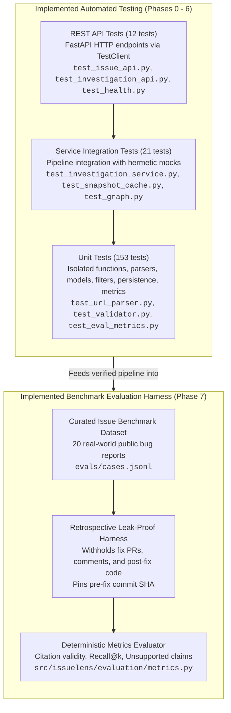
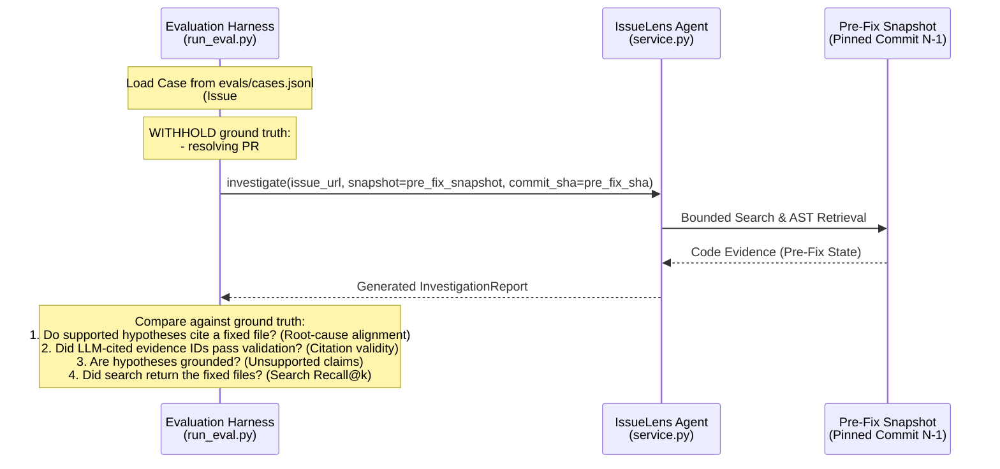

# Testing & Evaluation Architecture

This document details the testing architecture, test boundaries, mocking strategies, and evaluation framework of IssueLens. It covers both the **hermetic automated test suites** (Phases 0–6) and the **retrospective benchmark evaluation harness** (Phase 7).

---

## 1. Testing Pyramid & Verification Architecture

IssueLens enforces a rigorous hermetic testing discipline. Automated tests never depend on live external network connections, paid LLM vendor APIs, or live GitHub endpoints:



---

## 2. Implemented Test Organization & Boundaries

The automated test suite resides in `tests/` and contains **186 automated tests** executing completely offline in under 8 seconds:

```text
tests/
├── __init__.py
├── conftest.py                              # Global hermetic test database setup and loop policy
├── fixtures/                                # Hermetic test fixtures
│   └── sample_repo/                         # Sample repository snapshot fixture
│       ├── .env                             # Secret exclusion test fixture
│       ├── README.md                        # Documentation fixture
│       └── sample_pkg/
│           ├── __init__.py
│           ├── auth.py                      # Authentication symbol fixture
│           ├── database.py                  # Database connection symbol fixture
│           └── broken_syntax.py             # Intentionally invalid syntax fixture
└── unit/                                    # Hermetic test suites (186 total tests)
    ├── test_config.py                       # Configuration & secret masking (3 tests)
    ├── test_logging.py                      # Logging setup & secret redaction (4 tests)
    ├── test_health.py                       # Health & readiness probes (3 tests)
    ├── test_url_parser.py                   # URL validation & SSRF defense (14 tests)
    ├── test_github_models.py                # GitHub DTO parsing (3 tests)
    ├── test_github_client.py                # GitHub REST API client adapter (16 tests)
    ├── test_snapshot.py                     # Safe snapshot path containment (11 tests)
    ├── test_snapshot_cache.py               # Atomic caching & LRU pruning (8 tests)
    ├── test_code_search.py                  # Ripgrep & Python search engines (21 tests)
    ├── test_python_symbols.py               # AST symbol parsing & enclosing logic (5 tests)
    ├── test_snippets.py                     # Line-numbered snippet reader (6 tests)
    ├── test_report_schema.py                # Pydantic report schemas & provenance (7 tests)
    ├── test_llm_client.py                   # LangChain LLM client & error translation (11 tests)
    ├── test_prompts.py                      # Prompt templates & XML enclaves (5 tests)
    ├── test_validator.py                    # Citation validation & demotion (14 tests)
    ├── test_graph.py                        # LangGraph workflow, nodes, and tool traces (7 tests)
    ├── test_persistence.py                  # Models, migrations, repository, and restart (9 tests)
    ├── test_eval_dataset.py                 # Evaluation case models & JSONL parser (8 tests)
    ├── test_eval_metrics.py                 # Citation validity, recall@k & unsupported claims (9 tests)
    ├── test_eval_runner.py                  # Evaluation runner, CLI & DB persistence (4 tests)
    ├── test_issue_api.py                    # REST API issue endpoints (8 tests)
    ├── test_investigation_service.py        # End-to-end investigation pipeline (6 tests)
    └── test_investigation_api.py            # End-to-end REST API investigation flow (4 tests)
```

### Key Test Boundaries & Test Doubles

1. **GitHub Network Boundary**:
   - In [`tests/unit/test_github_client.py`](file:///c:/Projects/Issuelens/tests/unit/test_github_client.py), network requests are intercepted using `httpx.MockTransport`. No HTTP sockets are opened; tests provide synthetic responses for `/issues`, `/comments`, `/repos`, `/commits`, and zipball streaming.
   - For higher-level route and service tests, `FakeGitHubClient` implements [`GitHubClientProtocol`](file:///c:/Projects/Issuelens/src/issuelens/github/client.py), returning predetermined [`GitHubIssueContext`](file:///c:/Projects/Issuelens/src/issuelens/github/models.py) structures without serialization overhead.
2. **LLM Provider Boundary**:
   - In [`tests/unit/test_llm_client.py`](file:///c:/Projects/Issuelens/tests/unit/test_llm_client.py) and service tests, LLM interactions are decoupled via [`LLMClientProtocol`](file:///c:/Projects/Issuelens/src/issuelens/agent/llm.py).
   - Tests inject [`MockLLMClient`](file:///c:/Projects/Issuelens/src/issuelens/agent/llm.py), which records prompts and returns deterministic, valid (or deliberately malformed) [`InvestigationReportPayload`](file:///c:/Projects/Issuelens/src/issuelens/agent/report.py) objects.
3. **Repository Filesystem Boundary**:
   - Tests execute against a committed fixture repository at [`tests/fixtures/sample_repo/`](file:///c:/Projects/Issuelens/tests/fixtures/sample_repo).
   - Includes edge case files: [`broken_syntax.py`](file:///c:/Projects/Issuelens/tests/fixtures/sample_repo/sample_pkg/broken_syntax.py) (verifies syntax tolerance) and fixture `.env` (verifies secret exclusion).
4. **Database & Persistence Boundary**:
   - In [`tests/unit/test_persistence.py`](file:///c:/Projects/Issuelens/tests/unit/test_persistence.py), [`tests/unit/test_eval_runner.py`](file:///c:/Projects/Issuelens/tests/unit/test_eval_runner.py), and across the API test suite via [`tests/conftest.py`](file:///c:/Projects/Issuelens/tests/conftest.py), persistence operations run against in-memory SQLite (`sqlite+aiosqlite:///:memory:`) using `StaticPool` and `check_same_thread=False`.

---

## 3. Evaluation Architecture (Phase 7)

Phase 7 implements an automated benchmarking harness to measure investigation accuracy, citation validity, and hallucination rates across prompt and model versions.

### 3.1 Retrospective Leak-Proof Evaluation Protocol

When evaluating an AI debugging assistant against historical, resolved bug reports, **data leakage** is the most critical risk:
- If the agent is provided the pull request that resolved the bug, the eventual fix commit, or comments discussing the merged solution, the evaluation is contaminated and produces false results.
- If the agent inspects the repository at the `HEAD` commit (which already includes the fix), the bug will not exist in the inspected code.

#### Leakage Protection Measures:
1. **Withhold Fix Commit, PR, Comments, and Closed State**: PR numbers are rejected as targets; in live mode `EvaluationGitHubClient` removes all issue comments, presents the issue as open, and uses the issue text frozen in `cases.jsonl`. A missing pinned snapshot fails the case (`snapshot_unavailable`) instead of falling back to the default branch. (Comments were passed to the agent until the 2026-11-25 audit.)
2. **Pre-Fix Commit Pinning**: Every evaluation case in `evals/cases.jsonl` explicitly records the `target_commit_sha`: the commit immediately preceding the merged fix. The repository snapshot is pinned strictly to this pre-fix SHA.
3. **Double-Blind Evaluation**: The agent operates strictly with the initial issue description and pre-fix snapshot. The known resolution and expected relevant files are stored exclusively in the evaluation harness as ground truth labels, completely invisible to the agent.



### 3.2 Evaluation Metrics & Computation (metrics version 2)

Definitions and targets are maintained in [`evals/README.md` Section 4](../../evals/README.md#4-evaluation-metrics--targets-metrics-version-2) (single source of truth) and implemented in [`metrics.py`](../../src/issuelens/evaluation/metrics.py). Summary: root-cause useful rate (file-based, `>= 70%`), LLM citation validity over cited IDs (`>= 95%`), unsupported claims (`< 0.5`/report), Search Recall@5 (`>= 80%`) and Hit@5 (`>= 90%`), plus Diagnosis Hit@k and a keyword-overlap diagnostic with an issue-echo baseline. Quality means exclude failed runs, which are reported as the completion rate. See [ADR-013](../decisions/ADR-013-evaluation-metric-redesign-and-leak-closure.md) for why v1 metrics were replaced.

### 3.3 Evaluation Runner CLI & Machine-Readable Output

The benchmark harness is executed via CLI:

```powershell
uv run python -m issuelens.evaluation.run_eval --live            # writes evals/results.json
uv run python -m issuelens.evaluation.run_eval                   # mock harness check -> evals/results.mock.json
```

Outputs include:
1. **Console Summary Table**: Displays total cases, status counts, citation validity rate, Recall@k breakdown, and failure notes.
2. **Machine-Readable JSON Artifact**: `evals/results.json` (live) or `evals/results.mock.json` (mock, git-ignored, carries a warning that its metrics echo ground truth). Includes provenance: commit SHA, dirty-tree flag, metrics version, config.
3. **Database Records**: When `--save-db` is specified, records are persisted to `evaluation_cases` and `evaluation_results` tables.

---

## 4. Developer Quality Verification Commands

To verify code quality, type safety, and test coverage before committing:

```powershell
# 1. Run linter
uv run --offline ruff check .

# 2. Run static type checker
uv run --offline mypy src tests

# 3. Run full automated test suite
uv run --offline pytest

# 4. Run evaluation benchmark harness CLI
uv run --offline python -m issuelens.evaluation.run_eval --max-cases 5
```
