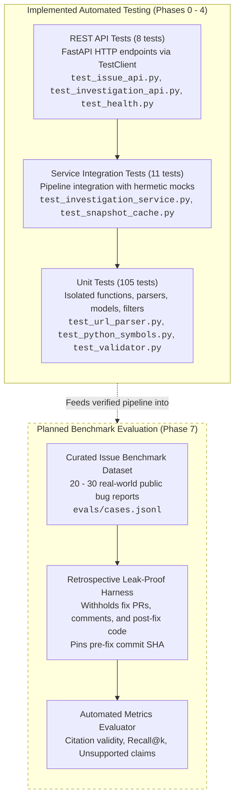
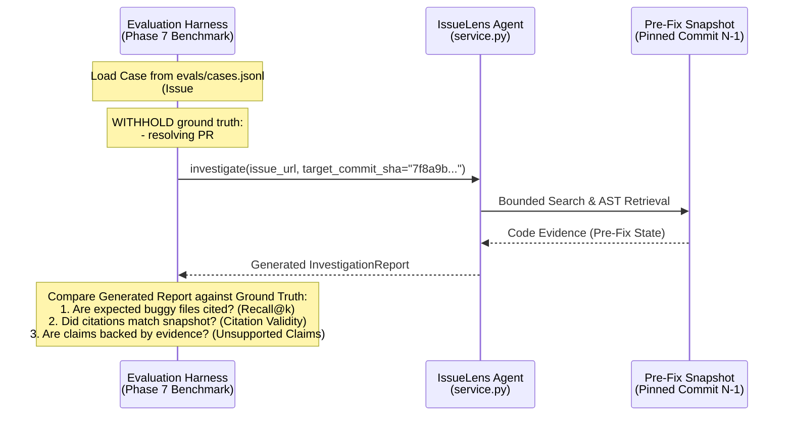

# Testing & Evaluation Architecture

This document details the testing architecture, test boundaries, mocking strategies, and evaluation framework of IssueLens. It explicitly differentiates **implemented automated test suites** (Phases 0–4) from **planned retrospective evaluation benchmarks** (Phase 7).

---

## 1. Testing Pyramid & Verification Architecture

IssueLens enforces a rigorous hermetic testing discipline. Automated tests never depend on live external network connections, paid LLM vendor APIs, or live GitHub endpoints:



---

## 2. Implemented Test Organization & Boundaries

The automated test suite resides in `tests/` and contains **124 automated tests** executing completely offline in under 5 seconds:

```text
tests/
├── __init__.py
├── fixtures/                                # Hermetic test fixtures
│   └── sample_repo/                         # Sample repository snapshot fixture
│       ├── .env                             # Secret exclusion test fixture
│       ├── README.md                        # Documentation fixture
│       └── sample_pkg/
│           ├── __init__.py
│           ├── auth.py                      # Authentication symbol fixture
│           ├── database.py                  # Database connection symbol fixture
│           └── broken_syntax.py             # Intentionally invalid syntax fixture
└── unit/                                    # Hermetic test suites
    ├── test_config.py                       # Configuration & secret masking (3 tests)
    ├── test_logging.py                      # Logging setup & secret redaction (4 tests)
    ├── test_health.py                       # Health & readiness probes (3 tests)
    ├── test_url_parser.py                   # URL validation & SSRF defense (14 tests)
    ├── test_github_models.py                # GitHub DTO parsing (3 tests)
    ├── test_github_client.py                # GitHub REST API client adapter (12 tests)
    ├── test_snapshot.py                     # Safe snapshot path containment (11 tests)
    ├── test_snapshot_cache.py               # Atomic caching & LRU pruning (8 tests)
    ├── test_code_search.py                  # Ripgrep & Python search engines (6 tests)
    ├── test_python_symbols.py               # AST symbol parsing & enclosing logic (5 tests)
    ├── test_snippets.py                     # Line-numbered snippet reader (5 tests)
    ├── test_report_schema.py                # Pydantic report schemas & provenance (7 tests)
    ├── test_llm_client.py                   # LangChain LLM client & error translation (11 tests)
    ├── test_prompts.py                      # Prompt templates & XML enclaves (4 tests)
    ├── test_validator.py                    # Citation validation & demotion (11 tests)
    ├── test_issue_api.py                    # REST API issue endpoints (8 tests)
    ├── test_investigation_service.py        # End-to-end investigation pipeline (6 tests)
    └── test_investigation_api.py            # End-to-end REST API investigation flow (3 tests)
```

### Key Test Boundaries & Test Doubles

1. **GitHub Network Boundary**:
   - In [`tests/unit/test_github_client.py`](file:///c:/Projects/Issuelens/tests/unit/test_github_client.py), network requests are intercepted using `httpx.MockTransport`. No HTTP sockets are opened; tests provide synthetic responses for `/issues`, `/comments`, `/repos`, `/commits`, and zipball streaming.
   - For higher-level route and service tests, `FakeGitHubClient` implements [`GitHubClientProtocol`](file:///c:/Projects/Issuelens/src/issuelens/github/client.py#L32), returning predetermined [`GitHubIssueContext`](file:///c:/Projects/Issuelens/src/issuelens/github/models.py#L79) structures without serialization overhead.
2. **LLM Provider Boundary**:
   - In [`tests/unit/test_llm_client.py`](file:///c:/Projects/Issuelens/tests/unit/test_llm_client.py) and service tests, LLM interactions are decoupled via [`LLMClientProtocol`](file:///c:/Projects/Issuelens/src/issuelens/agent/llm.py#L23).
   - Tests inject [`MockLLMClient`](file:///c:/Projects/Issuelens/src/issuelens/agent/llm.py#L87), which records prompts and returns deterministic, valid (or deliberately malformed) [`InvestigationReportPayload`](file:///c:/Projects/Issuelens/src/issuelens/agent/report.py#L87) objects.
3. **Repository Filesystem Boundary**:
   - Tests execute against a committed fixture repository at [`tests/fixtures/sample_repo/`](file:///c:/Projects/Issuelens/tests/fixtures/sample_repo/).
   - Includes edge case files: [`broken_syntax.py`](file:///c:/Projects/Issuelens/tests/fixtures/sample_repo/sample_pkg/broken_syntax.py) (verifies that `ast.parse` handles `SyntaxError` without crashing) and a fixture `.env` (verifies that secret files are excluded from searches and file listings).

---

## 3. Planned Evaluation Architecture (Phase 7)

Phase 7 introduces an automated benchmarking harness to measure investigation accuracy, citation validity, and hallucination rates across prompt and model versions.

### 3.1 Retrospective Leak-Proof Evaluation Protocol

When evaluating an AI debugging assistant against historical, resolved bug reports, **data leakage** is the most critical risk:
- If the agent is provided the pull request that resolved the bug, the eventual fix commit, or comments discussing the merged solution, the evaluation is contaminated and produces false results.
- If the agent inspects the repository at the `HEAD` commit (which already includes the fix), the bug will not exist in the inspected code.

#### Leakage Protection Measures (Phase 7 Design):
1. **Withhold Fix Commit & PR**: The evaluation runner completely withholds all pull requests, fix commits, and subsequent issue comments containing references to the resolving PR or commit SHA.
2. **Pre-Fix Commit Pinning**: Every evaluation case in `evals/cases.jsonl` explicitly records the `target_commit_sha`: the commit immediately preceding the merged fix. The repository snapshot is pinned strictly to this pre-fix SHA.
3. **Double-Blind Evaluation**: The agent operates strictly with the initial issue description and pre-fix snapshot. The known resolution and expected relevant files are stored exclusively in the evaluation harness as ground truth labels, completely invisible to the agent.



### 3.2 Evaluation Metrics & Computation

The Phase 7 benchmark evaluates the following five quantitative metrics:

| Metric | Definition & Computation | Target Benchmark |
| :--- | :--- | :--- |
| **Citation Validity Rate** | `valid_code_citations / total_code_citations`. Fraction of citations whose path and line range exist and whose excerpt matches physical bytes in the snapshot. | `>= 95%` |
| **Retrieval Recall@k** | `cases_with_target_file_retrieved / total_cases`. Whether the ground-truth buggy file appears in the top $k$ retrieved code hits. | `>= 80%` (at $k=5$) |
| **Evidence Relevance** | Human-labeled assessment: whether retrieved snippets provide necessary context to explain the bug. | `>= 75%` |
| **Root-Cause Accuracy** | Fraction of cases where the top-ranked hypothesis correctly identifies the underlying fault mechanism. | `>= 70%` |
| **Unsupported Claim Count** | Number of factual assertions in `observed_facts` or `hypotheses` not backed by retrieved evidence items. | `< 0.5` per report |

---

## 4. Developer Quality Verification Commands

To verify code quality, type safety, and test coverage before committing:

```powershell
# 1. Run linter
uv run ruff check .

# 2. Run static type checker
uv run mypy src tests

# 3. Run full automated test suite
uv run pytest
```

